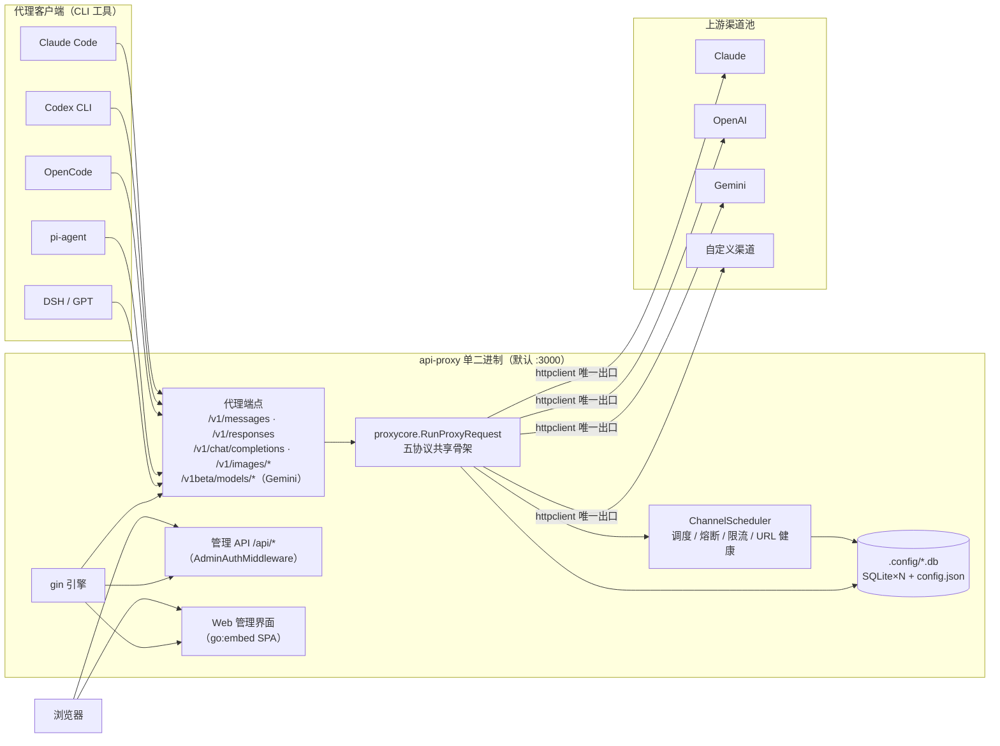
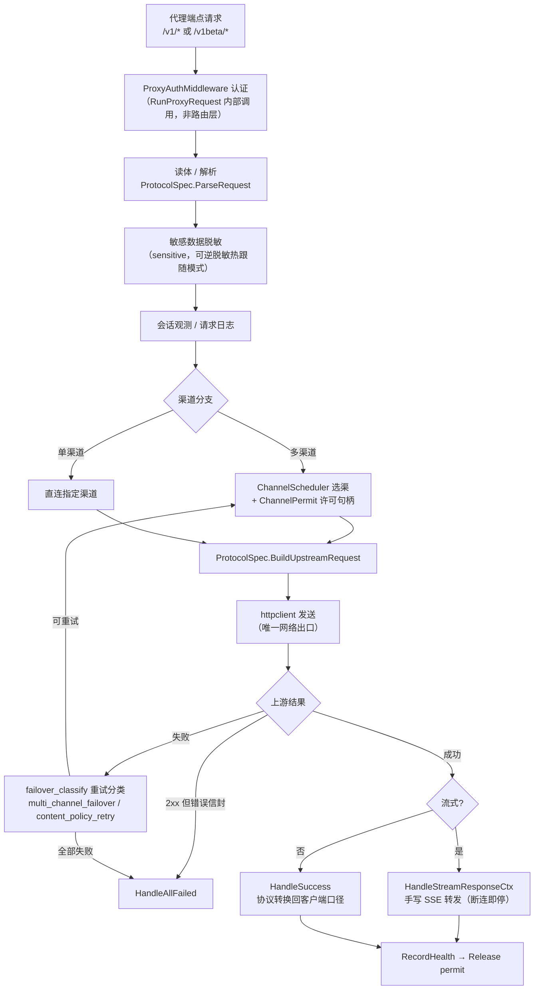
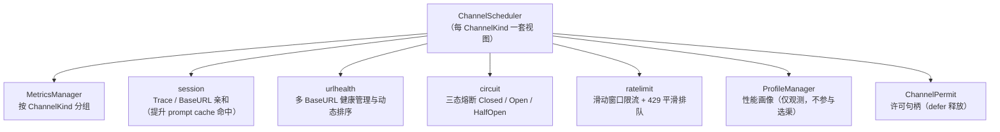
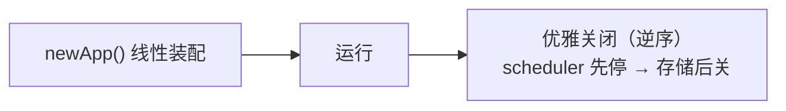
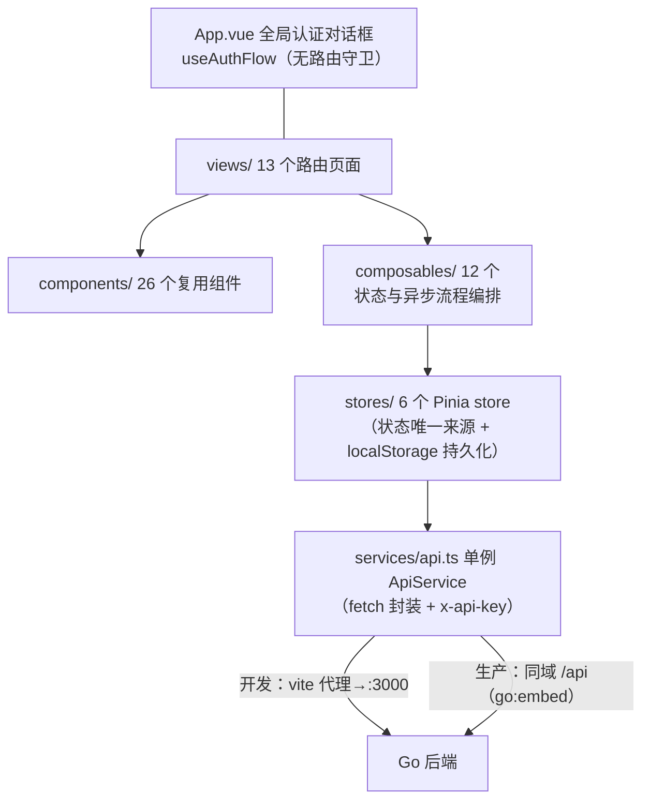

# 架构说明（architecture）

整体架构、请求流转、调度体系与数据存储。改动跨模块逻辑前必读。规范与不变量见 [规范与不变量.md](规范与不变量.md)。

## 1. 整体形态：单二进制一体化

前端（Vue 3）构建产物经 `go:embed` 嵌入 Go 后端，一个可执行文件同时服务代理客户端与管理界面浏览器。

关键区分：**ChannelKind（messages/responses/gemini/chat/images，五协议入口的口径）≠ upstream ServiceType（openai/claude/gemini/responses，上游服务类型）**，`scheduler/channel_scheduler.go:37-39` 有明确注释。

## 2. 代理请求流转（五协议统一入口）

所有代理端点收敛到 `proxycore.RunProxyRequest`（`handlers/proxycore/protocol.go:77+`），协议差异通过 `ProtocolSpec`（protocol.go:26-61，含 ParseRequest / BuildUpstreamRequest / HandleSuccess / HandleAllFailed 等钩子）注入。

要点：

- 新增协议 = 实现 ProtocolSpec 钩子 + 注册端点，不另起炉灶（messages/handler.go:31-86 是典型示例）
- 流式响应必须用 `HandleStreamResponseCtx`（带 context），客户端断连立即停读上游，避免 goroutine 泄漏
- `ChannelPermit`：取得后 defer 释放，结束时 RecordHealth 恰好一次再 Release，均可幂等重复调用
- Messages→Responses 转换时 provider 实例存 gin context 复用，成功阶段必须复用同一实例否则丢 previous_response_id 链
- Claude→Claude（`serviceType=claude`）非流式响应在 usage 未被改写时原样下发，保留 `safeguards` / `safeguard_results` 等未知字段，不改写 tool-use ID；需要校正 usage 时只改对应字段。其他上游仍做协议转换，不能承担 Claude Code 服务端分类器

## 3. 调度与稳定性体系

- **生产选渠严格按配置顺序**；性能画像仅观测不参与选渠（main.go:209-215，"R6：修正历史误导日志"）
- 失败率只用来跳过不健康渠道，不参与重排；Fuzzy 不决定是否换下一个渠道。熔断同时看连续失败和错误率（默认见 `CIRCUIT_FAILURE_THRESHOLD` / `CIRCUIT_ERROR_RATE` / `CIRCUIT_MIN_REQUESTS` / `CIRCUIT_COOLDOWN_SECONDS`）
- 渠道状态：active/suspended/disabled（config.go:37），另有 promotion/temporary/deprecated 生命周期（channel_lifecycle worker）
- 五组渠道配置（upstream / responsesUpstream / geminiUpstream / chatUpstream / imagesUpstream）支持 modelMapping 一对多、poolId、vision layer 等调度字段

## 4. 应用装配与生命周期

`newApp()`（main.go:69-380）线性装配：EnvConfig → logger → ConfigManager → 内容安全存储 → sessionManager → metrics → conversationRegistry → URLManager → ChannelScheduler → circuit → CmdGate/内容安全管道 → 可逆脱敏 → piAgent/skills/assistant/eval API → gin 引擎。

- 初始化失败按 `registerCleanup` **逆序清理**（main.go:74-84）
- shutdown 同样逆序：先停数据生产者（scheduler）再关存储；**app struct 字段顺序即构造顺序，两者不可调换**（main.go:37-38、app_lifecycle.go:88-91）

## 5. 前端架构

- 认证是全局对话框模式：未认证时弹密钥 dialog 挡住整个应用，5 次失败锁 5 分钟；仅 401 视为密钥无效
- 五种协议类型（`ApiTab`）贯穿全栈：store 收敛为 `Record<ApiTab, ...>`，`channelApi(type)` 工厂查表返回统一方法集；新增协议要同步改多处
- 错误语义：`ApiError.committed` 表示"配置已原子提交但收尾失败"，此时不自动重试，提示用户刷新
- SSE 因需鉴权用 fetch + readSSEStream 而非 EventSource

## 6. 数据存储

全部 SQLite（modernc.org/sqlite，WAL，`SetMaxOpenConns(1)`），位于运行目录 `.config/`，无 migration 框架（建表靠 `CREATE TABLE IF NOT EXISTS` + config 包内 JSON 迁移）：

| 文件 | 用途 | 使用方 |
|---|---|---|
| `config.json` | 主配置（五组渠道 + settings），热重载，保留 10 份备份 | ConfigManager |
| `logs.db` | 运行日志与请求正文 | logger、cli（`api-proxy logs`） |
| `blocked-logs.db` | 拦截记录 + 危险命令闸门 | sensitive、llmgate |
| `conversations.db` | 对话注册表 + Responses 会话 | conversation、session |
| `metrics.db` | 指标持久化（可选） | metrics |
| `redaction-mappings.db` + `master-key` | 可逆脱敏持久映射（AES-256-GCM） | sensitive（Veil ADR 0004） |
| `assistant.db` | AI 配置助手 | assistant |
| `eval.db` | 评测工作台题库与批次 | eval |

## 7. 鉴权模型（三层）

| 层 | 中间件 | 保护对象 | 密钥来源 |
|---|---|---|---|
| 页面开关 | WebAuthMiddleware | WebUI 页面（ENABLE_WEB_UI） | 只管页面开关，不碰管理业务 |
| 管理 API | AdminAuthMiddleware（**必须显式绑定在路由组上**，漏绑会打 `[Auth-Warn]`） | `/api/*` | PROXY_ACCESS_KEY |
| 代理端点 | ProxyAuthMiddleware（RunProxyRequest 内部调用） | `/v1/*`、`/v1beta/*` | x-api-key / Authorization Bearer / x-goog-api-key 三种提取方式 |

`/health` 固定公开（与 Dockerfile HEALTHCHECK 一致）。v3.3.0 修复过 WebAuthMiddleware 扩展名绕过（7e0b11b），改动鉴权相关代码时格外谨慎。
