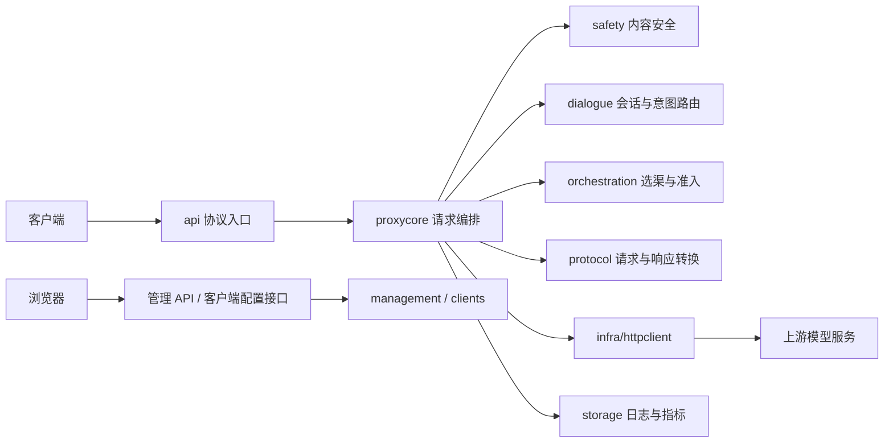

# 架构说明

Go 后端与 Vue 管理台共用一个进程、一个端口（默认 3000）。前端静态资源在构建时嵌入二进制。后端目录职责见 [后端约定](../backend-go/AGENTS.md)，前端目录见 [前端约定](../frontend/AGENTS.md)。

## 请求经过哪些模块

cmd/server 负责依赖装配、路由和生命周期，其中 main.go 是进程入口，app.go 装配运行组件，app_routes.go 注册路由，app_lifecycle.go 管理停机。api 处理 HTTP 与协议差异；管理接口按会话、扩展、意图、日志、安全和设置分包。通用请求流程由 proxycore.RunProxyRequest 编排，差异通过 ProtocolSpec 注入。安全、转换和调度组件不反向依赖 HTTP 接入层。

newApp 按配置与日志、用量记录、存储、调度、安全、客户端和 HTTP 路由分步装配。技能翻译适配、画像初始化和安全历史清理分别由所属模块提供入口；渠道集合从配置字段映射导出，调度器按 ChannelKind 接收指标管理器，避免依赖位置参数表达协议关系。

客户端配置接口集中在 clients 顶层；piagent、mcpsync、skills 子包处理配置与文件操作，extensions 子包负责 Skills / MCP 统一目录迁移，均不依赖 HTTP。跨盘迁移先复制完整目录再清理源目录；源目录部分清理失败时保留完整目标副本，并返回路径和恢复提示。前端的 app 组合业务流程，features 各自拥有视图与服务，通过少量公开出口协作；shared 提供通用能力，types 保存契约。

模型指纹检测通过管理鉴权下的 `POST /api/channels/:id/fingerprint` 创建后台任务，`:id` 为稳定渠道 ID；`GET` 同一路径查看最近一轮任务，`DELETE /api/channels/:id/fingerprint/:taskId` 显式停止指定任务。management/modelfingerprint 固定渠道快照、实际 URL、Key、模型与思考档位，直接构造原生文本请求；不进入 proxycore、意图匹配、模型映射、历史会话、安全处理及提示词改写。传输仍遵守渠道代理、TLS 和共享准入，客户端身份沿用快捷测试使用的 Codex / Claude Code 伪装函数（包括必要的 Claude 计费标记）。采样失败不更换目标，也不跟随 HTTP 重定向。任务独立于管理连接，关闭弹窗或刷新页面不取消；每渠道最多一个运行任务，整轮限时 10 分钟，进程停机先取消并等待任务退出。参考库和最近一轮任务保存在启动工作目录的 `.config/model-fingerprint/`，结果不保存凭据；重启后未完成任务标记中断，不自动重发。检测结果来自 lm-detector 的参考库内统计排名，不作为模型身份认证。

`POST /api/channels/:id/fingerprint/:taskId/retry` 补测原任务内失败、截断或已停止的样本；`POST /api/channels/:id/fingerprint/:taskId/samples/:sampleIndex/retry` 仅重试指定失败样本（序号从 0 开始）。两者沿用原任务和挑战，保留成功样本；批量补测中某条再次失败仍继续尝试其余失败项，全部尝试后重新计算一次整轮排名。禁止重试进行中的任务或成功样本，无失败项时显式返回错误。凭据只保留在进程内快照；重启后按已记录目标及配置摘要核验后恢复，参考库构建时间、数据 SHA-256、评分器摘要或已记录 SDK 版本变化则拒绝混合重试。本地加载额外校验 SDK 缓存中的完整评分数据 SHA-256 与发布清单相符；更新 SDK 时须同步核对缓存布局与格式版本。

前端基础控件位于 `shared/ui/`，通用组合组件位于 `shared/components/`。`shared/theme/` 把浏览器主题偏好应用到 `html`，页面、浮层和图表共同消费 `styles/theme/` 的令牌。目录职责和扩展方式见 [前端设计系统与主题](前端设计系统与主题.md)。

## 协议与渠道

| 类型 | 入口 | 行为 |
|---|---|---|
| 五类编排协议 | `/v1/messages`、`/v1/responses`（含 compact）、`/v1/chat/completions`、`/v1beta/models/*`、`/v1/images/*` | 统一选渠、重试与安全处理，按上游能力转换 |
| 原样透传 | `/v1/embeddings`、`/v1/decisions` | 路由到对应上游，保留请求与响应格式 |

ChannelKind 表示 messages / responses / chat / gemini / images / embeddings / decisions 七类入口分组；ServiceType 表示上游实际协议。Images 支持原生 Images 上游与 Responses 生图上游。

渠道允许全部删除。删除自定义分组时会一并删除其全部渠道（包括暂停、备用、弃用及纯图片理解渠道），由后端原子提交。渠道与分组的 `GET /api/{kind}/channels/{id}/deletion-impact`、`GET /api/{kind}/pools/{id}/deletion-impact` 返回删除范围及图片理解引用渠道，供组件确认框展示；预览不修改配置。删除时按最新配置关闭引用方的图片理解支持和图片理解层，清空图片理解渠道与模型选择，与删除一同提交；写入失败保持原配置。兜底分组与内置免费分组不能删除，被意图路由引用的分组须先解除意图引用。

内部意图分类和命令闸门可通过 Decisions 调用结构化辅助问答；systemone 只保留为旧配置别名，不请求 `/v1/systemone`。这不约束对外 Decisions 透传的载荷格式。

## 主请求流程

鉴权与读体 → 安全处理与会话识别 → 选组、选渠 → 构建上游请求 → 共享准入 → HTTP 发送 → 响应转换 / SSE 转发 → 关闭响应体、释放许可、记录日志和健康结果。

- 正常选渠遵循配置顺序；促销只在同组生效，会话绑定优先。性能画像只供观测。
- 共享准入按解析后的上游服务地址、协议、Key 聚合；自动补版本与完整端点的等价写法、默认端口共享并发和冷却。自定义路径、查询参数及非默认端口保持区分。
- 重试受发送次数和累计排队预算限制。流已交付后不能当作完整失败重新发送。
- 意图路由共用预览与实际决策快照；驻留、工具续轮、加密历史和人工固定具有保护规则。免费组需配置能力且服务启用才参与自动选组，不新增跨组故障转移。
- 流式处理传播请求 Context，客户端断开或处理结束时关闭上游 Body。

`infra/httpclient` 按客户端缓存、传输与超时、发送准入、响应体释放和观测分文件。调用方通过 `ClientOptions` / `SendOptions` 传入配置快照，不读取进程级全局网关设置。缓存按最近使用顺序最多保留 128 组客户端，淘汰及进程停机时关闭空闲连接；在途请求继续完成。

共享客户端直接返回 3xx，不跟随重定向，避免正文和上游凭据被转发到其他地址、实际目标绕过准入身份；依赖跳转的渠道须改为最终接口地址。发送层不按 TLS 错误文本隐式重放请求，重试由编排层决定。普通请求保留整体超时；流式响应头阶段预算包含连接、上传和等待响应头，从取得准入名额后开始，收到响应头即停止，后续正文由空闲超时和客户端取消控制。

上游身份由 `infra/upstreamreq` 复用 URL 拼接规则解析协议主端点，`orchestration/upstreamcontrol/identity.go` 负责主机与默认端口归一化、凭据摘要和持久化指纹；控制器负责队列和名额，`request.go` 负责请求预算，`cooldown.go` 负责共享冷却策略和只读快照。新增协议时需登记其主端点与明确共享额度的操作。队列在取消、超时、放行或配置移除后清空对应引用，空队列释放底层数组。

身份指纹使用新的版本域，旧版按原始 BaseURL 计算的归属不会被猜测为新身份。Responses 遇到归属不匹配时，沿用本地历史恢复流程：历史完整则移除旧 previous_response_id 后发送完整输入，历史缺失则明确要求客户端重新提供完整对话。可用性观测按新身份重新积累，旧样本仍保留在存储中。

可用性观测与免费选模共用结果分类；本地意图状态保存失败归为排除样本，不污染上游失败率。共享凭据冷却只由 upstreamcontrol 执行，管理台读取其当前截止时间，跨模型共享且不会被在途成功或较短 Retry-After 提前清除。免费选模将这类等待交给发送准入，不用历史冷却估计排除模型。只有明确的模型容量错误且上游提供有效 Retry-After 时，才按模型记录冷却并过滤候选；缺失或无效值不补造 30 秒等待。两条路径复用 Retry-After 解析，秒数从收到响应头时起算。旧观测中的估计冷却不再用于控制请求，原始样本仍保留。

URL 健康由 `orchestration/urlhealth` 管理，只调整尝试顺序，不禁止尝试候选。地址达到连续失败阈值才降序；未达阈值按当前配置顺序，达到阈值后按冷却状态与失败次数排序。修改地址列表时按 URL 保留仍存在地址的健康记录，候选索引重新对应本次配置；单地址和空列表也同步状态。

主请求、内部文本调用和图片理解共用 `infra/upstreamreq` 的地址故障判定。HTTP 认证、配额和请求拒绝，以及结构化错误码明确的模型、凭据和限流错误，不计为地址故障；408、未被业务错误解释的 5xx 和未知的 2xx 错误信封才计入。网络和读体失败由调用方单独记录。结构化错误分类同时供可用性观测使用，避免各调用链维护不同的错误码表。

代码修改必须保留的具体约束见 [规范与不变量](规范与不变量.md)。

## 数据与观测

配置文件加载和管理写入共用校验入口，统一检查全局设置、协议能力及渠道引用。缺失字段和旧格式只在加载阶段迁移；无效候选不发布。模型映射仍引用某渠道时，须先解除映射才能删除目标渠道。伪装设置变更通过专用合并通知交给唯一的版本同步任务。

历史 Key 在启用指标持久化后由指标库保存。变化时先将完整历史 Key 快照及 `historicalKeysPending` 标记随配置原子提交，再同步指标库，成功后移除磁盘中的历史 Key 和标记。同步失败返回 `committed: true`，后续保存或重启按完整快照继续恢复，不能将旧数据库合并回待同步快照；指标持久化关闭时仍随配置保存。该流程保证中断可恢复，不承诺文件和数据库之间的原子事务。

运行数据放 `.config/`：config.json 保存配置；SQLite 分别保存日志、拦截与审核、会话、指标、脱敏映射；master-key 保存脱敏主密钥。该目录不可入仓。

内容安全在请求绑定管线时固定设置快照，输入检查、响应检查及流式检查沿用同一份设置。mask 模式的请求直接绑定持久映射库，设置切换立即作用于新请求。占位符还原未命中时，使用当前请求的协议、渠道、模型及请求和会话标识记录审计；映射读写或审计失败显式返回错误。

可逆脱敏先提取协议正文与工具业务字段，保留字段名作为检测语境；全部规则完成后，再把本请求和授权会话中已知的原值覆盖到全部受检片段，避免敏感值换语境或出现在较早历史中漏检。工具说明可改写；数字、对象键、schema 枚举/默认值及签名绑定文本命中时阻断。嵌套 JSON 字符串在值替换后由内向外序列化，不能直接替换转义后的整段参数。新占位符使用中性的 `MASKED_<TYPE>_<TOKEN>_END`，兼容旧 `_PRESERVE_EXACTLY`，不添加系统提示或恢复指令。

跨请求恢复要求代理鉴权密钥与稳定的显式 conversation/thread/session 标识共同确定范围。仅有 `previous_response_id`、窗口标识或缓存键时不授予历史恢复权限；只使用当前请求重新识别出的映射。原加密映射表保留，新建会话授权表；旧映射须通过重新识别原值取得该会话授权，不能凭占位符查全库。共享代理密钥不构成多租户认证边界。每请求最多 8192 条/8 MiB 映射，全库会话与授权各有 100000 条上限；达到上限明确失败。映射沿用 90 天保留策略，读取授权映射不逐条刷新访问时间；过期、清理或 LRU 淘汰会使关联会话不可继续按旧映射处理，需要用完整原始历史建立新会话。

检测快照使用两代有界缓存，仅保存文本摘要、规则与字节区间（每代最多 2048 条缓存/8192 个命中），不保存正文。旧代命中提升到当前代；身份证检测按 UTC 日期失效。审计复用凭据区间，每个请求仍保留独立审计记录；最多每 256 条或约 1 MiB 缓冲同步提交，写入失败阻断，不使用后台丢弃队列。已知原值覆盖始终重算；请求内改写缓存也校验映射代数。

映射库缓存最多 32 个会话，按估算内存 16 MiB 淘汰，固定 5 分钟到期并由每分钟清理回收引用；有效期也不超过其中最早过期映射。缓存暂存授权明文及替换表，落盘仍加密；Go 内存回收不承诺物理擦除。每轮通过数据库事务核对失效状态和授权版本，版本不变才复用；新增或撤销授权、修改密文、缩短有效期会失效。请求复制 map，共享不可变字符串和替换表，新映射使本请求替换表失效。关闭映射库时清缓存，不跨映射库实例共享。仍有全量 JSON 读取、摘要、已知值覆盖、映射写入和同步审计成本，不能宣称只处理新增消息；命令 AI 审核属于独立延迟来源。性能效果需以真实历史长度及并发基准验证。

内容安全设置突出个人信息、凭据和危险命令；关闭的规则组折叠，白名单、放行字面量及自定义规则放在高级区域。敏感词不再提供管理台开关，旧配置启用时明确提示，保存本页后关闭，后端保留旧接口兼容。危险命令只检查支持的执行工具；未启用 AI 闸门时命中直接阻断，启用后 AI 判安全立即交付，判危险才等待人工决定，超时或审核故障阻断。事后否决不能撤销已执行命令，也不替代 Agent 本机权限与沙箱。非流式拦截返回 403，流式发送协议错误与终止事件；客户端可能停止或重试，兼容性需逐客户端验证。

系统通知统一在消息中心选择关闭、仅命令审核、仅警告或全部消息；旧命令通知偏好继续按仅命令审核生效。新消息按范围发送浏览器 Notification，旧消息加载不重放；系统弹窗不携带正文或命令，点击回到管理台。必须使用 HTTPS 或 localhost、获得站点与系统权限，并保持管理台页面运行；页面关闭、休眠、后台节流、断网或勿扰模式下不能保证送达。没有后台 Web Push 或本地托盘服务；Go 服务端可能在远程主机或容器内，不直接向访问者桌面发通知。消息中心提供测试入口，失败可见，但 API 创建成功不等于操作系统一定展示。

流式请求通常是完整 JSON 上行、SSE 下行；请求侧在转发前完成检测，下行按逻辑字段保留占位符尾部。工具参数在完整校验后交付，未知或破损占位符报错，业务字段 name/id/type 正常恢复。与标识符粘连的占位符不满足精确恢复边界时阻断；流式参数中的嵌套 JSON 或 Unicode 转义若无法保证增量还原与完整还原一致，也会阻断，可改用非流式请求。普通正文中的未知标记保留并审计。签名思考块不还原；签名工具参数需要改写时拒绝交付。该层不承诺图片/附件/OCR、编码或拆散的秘密、未知扩展字段、白名单放行内容及模型自行推断出的敏感信息得到全面保护，也不能让上游托管工具取得只保存在本地的原值。

logs.db 记录调用生命周期、尝试、工具关联与受限正文；正文按哈希去重。请求入口固定采集策略，运行日志、调用和正文分别设置保留期。存储预算是软上限，超预算时新请求降为元数据；写入拒收或失败会报告错误，详情超限返回 413。

观测只覆盖网关收到与发出的内容。上游状态、客户端 HTTP 状态和处理结果分别记录；流式 HTTP 200 不表示最终成功，工具关联不表示客户端工具已执行。

用量手账从管理台「运行观测 → 用量手账」启用，首次启用固定时区与记录起点。`/api/usage-journal/*` 走管理鉴权，提供状态、启用、按年日历与每日票据。代理尝试收尾分别向账本和运行日志交付结果。`usage-ledger.db` 的事实去重和小时、模型汇总在同一事务内完成。清理调用日志或渠道不会清除账本。估算与未知用量单独统计；明确的限流拒绝信封不制造用量缺口，拒绝响应若报告用量仍入账。超出本次输入总量的缓存明细不参与成长，账本保留本次输入总量。批满会唤醒写入器，成功后连续排空积压，失败会间隔重试。缓冲溢出、非正常退出及账本打开失败期间会留下覆盖缺口，打开失败通过 `.unavailable` 标记在恢复时补记。原生图片仅在账本启用后旁路采集，按块剔除长图片字符串，元数据缓冲有界，压缩数据流式解码，原始响应保持透传。每日票据按去重后的事实与覆盖缺口计算版本，跨统计日才入账的事实会在原日期显示补记提示。[个人森林与用量手账方案](个人森林与用量手账方案.md)

森林从已提交用量游标读取上游报告的 Token，`management/forest` 将游标、三类成长、发现记录、奖励和布局提交到独立的 `forest.db`。基准暂时不可用时，继续用已保存的基准结算。每 96 棵树扩一座岛，每 8 座岛扩一片群岛。`/api/forest/*` 走管理鉴权，提供分层地图、按日种植记录、编辑、兑换和计时。计时命令检查状态版本，专注到期由后端入账，休息由用户确认后入账，Agent 等待独立记录。停机时先停止森林消费，再排空并关闭用量账本，剩余的已落盘用量在下一次启动时继续结算。

## 鉴权与停机

启动时由 `LoadEnvConfig` 读取并校验六项核心环境变量；缺失使用默认值，显式无效值停止启动。存在但无法读取或解析的 `.env` 也停止启动。`DefaultEnvConfig` 仅构造默认配置，运行请求使用已发布的设置快照，不重复读取环境变量。历史 Key 启动同步失败同样中止启动并保留恢复信息。

`/api/*` 和 `/admin/*` 路由组显式挂载 `AdminAuthMiddleware`，代理入口使用 `ProxyAuthMiddleware`。`WebAuthMiddleware` 处理 `ENABLE_WEB_UI` 开关，`/health` 始终公开。

停机先排空 HTTP 请求，再停止后台生产者，最后排空日志并关闭存储。后台生产者与存储分开登记，各阶段内部按登记顺序逆序清理，启动失败也遵循同一顺序；配置监听必须先于其依赖的历史 Key 指标存储停止。一项清理失败不阻断其余清理，错误统一返回。

## 设计决策

- **内嵌管理台**使代理和界面可以由一个二进制和一个端口交付。`RunProxyRequest` 将各协议共有的选渠、重试、安全处理和日志收在同一条流程中。
- **按实际凭据共享准入**使共用 URL、协议和 Key 的逻辑渠道共用并发上限，避免拆出多个渠道后叠加真实上游的负载。
- **保留用量观测**以便排查调用次数、Token、延迟和速率。网关缺少可核验的上游扣费凭证，因此移除了计费统计功能。
- **可逆脱敏**在请求中隐藏敏感值，并在响应中还原引用，让客户端可以继续使用原始内容。

版本沿革与功能变更见 [CHANGELOG.md](../CHANGELOG.md)。
