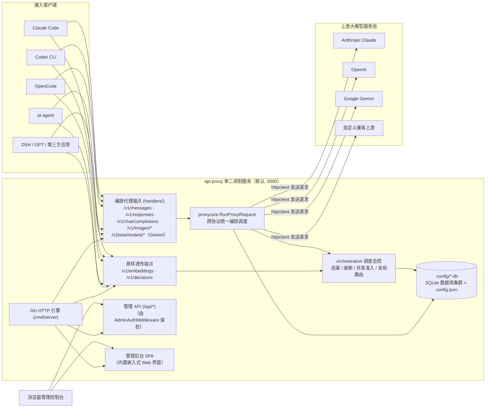
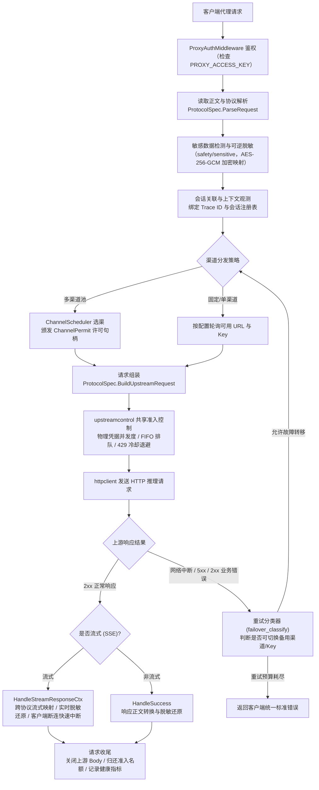
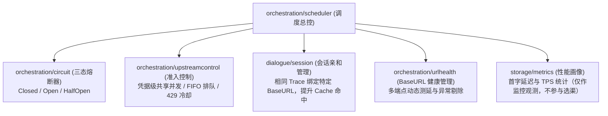

# 架构说明（Architecture）

本文档面向开发者和维护者，详细介绍 **api-proxy** 的整体设计思想、代码分层架构、核心请求处理流水线、稳定性控制体系以及数据存储架构。

---

## 1. 整体架构：单二进制一体化网关

api-proxy 采用 Go 后端 + Vue 3 前端的架构。在编译构建时，前端静态资源通过 Go 原生的 `go:embed` 技术完整嵌入后端程序，最终产出单一可执行文件。

在部署时，网关仅需占用单个端口（默认 3000），即可同时对外提供代理服务、管理接口与可视化控制台：



---

## 2. 后端核心分层（backend-go/）

后端入口位于 `cmd/server/`，核心实现按 9 大领域模块划分在 `internal/` 中：

```
backend-go/
├── cmd/server/               # 主程序入口与装配
│   ├── main.go               # newApp() 线性依赖装配与生命周期管理
│   ├── app_routes.go         # 路由装配（管理组、代理端点、健康检查）
│   └── app_lifecycle.go      # 控制台横幅、脱敏热跟随、优雅停机
└── internal/                 # 9 大领域模块
    ├── handlers/             # 协议端点处理层（proxycore 统一编排、各协议端点、hooks、streams）
    ├── orchestration/        # 调度与稳定性控制（scheduler 选渠、circuit 熔断、upstreamcontrol 共享准入、urlhealth）
    ├── protocol/             # 协议抽象与转换（converters 跨协议转换、providers 请求构造与响应解析）
    ├── safety/               # 内容安全与风控（sensitive 脱敏、llmgate AI 命令闸门、bodyfilter、visionlayer）
    ├── dialogue/             # 会话与上下文治理（session 会话与亲和性、conversation 对话注册表、copilotopt）
    ├── storage/              # 持久化存储与观测（sqlitedb、logger 日志与调用聚合、metrics 指标）
    ├── admin/                # 后台管理支撑服务（assistant 配置助手、channelcrud、modelcatalog、skills）
    ├── infra/                # 基础设施（config 配置热重载、httpclient HTTP 出口、middleware、utils、cli）
    └── eval/                 # 渠道评估与测试探针
```

---

## 3. 协议体系与渠道模型

### 3.1 代理端点分类

- **五大编排协议统一入口**：
  - Claude Messages (`/v1/messages`)
  - OpenAI Responses (`/v1/responses`，含 `/compact`)
  - OpenAI Chat (`/v1/chat/completions`)
  - Google Gemini (`/v1beta/models/*`)
  - Images (`/v1/images/*`)
  这五类端点由 `handlers/proxycore.RunProxyRequest` 统一编排，支持在 Claude、OpenAI 与 Gemini 之间进行双向格式与流式事件转换。
- **两大原样透传端点**：
  - OpenAI Embeddings (`/v1/embeddings`)
  - Decisions (`/v1/decisions`)
  透传端点直接根据配置路由到目标上游，不经过复杂的会话改写与推理转换。

### 3.2 渠道分组（ChannelKind）与上游协议（ServiceType）

- **内部渠道分组（ChannelKind）**：系统在调度与管理层维护 7 类渠道分组（`messages`、`responses`、`chat`、`gemini`、`images`、`embeddings`、`decisions`），每类分组拥有独立的渠道列表、指标统计与管理端点。
- **上游服务类型（ServiceType）**：标识物理上游的真实协议（如 `claude`、`openai`、`gemini`、`responses`）。入口渠道类型与上游协议解耦，由转换层在内存中桥接。
- **Images 渠道的两种上游**：支持原生 OpenAI Images 接口，也可以通过 OpenAI Responses 生图上游代理（网关自动将工具调用返回转换为统一的 Base64 格式）。

---

## 4. 请求生命周期与执行流转

所有编排类代理请求均由 `handlers/proxycore/protocol.go` 中的 `RunProxyRequest` 统一编排，协议特有逻辑通过 `ProtocolSpec` 钩子注入：



### 关键机制说明

1. **凭据级共享准入控制（upstreamcontrol）**：
   - 准入控制按 `[目标 URL + 实际上游协议 + API Key]` 物理三元组进行全局聚合并发（默认上限 5）和 FIFO 排队（最多 3 个、等待 10 秒）；
   - 彻底避免管理员配置多个逻辑渠道指向同一个 Key 时，并发叠加击穿上游配额导致 429 封禁。
2. **流式 Context 深度绑定与中断感知**：
   - 流式响应采用 `HandleStreamResponseCtx` 处理。上游网络连接与客户端 Gin 上下文绑定；
   - 只要客户端断开连接（如中断请求或关闭标签），后端立即终止上游读取并关闭 Body，防止上游持续推理扣费及本地 goroutine 泄漏。
3. **全局重试预算控制**：
   - 单次客户端请求在网关内部受到全局重试预算约束（最多尝试 12 次向上游发送、累计准入等待不超过 30 秒），防止死循环消耗系统资源。

---

## 5. 调度与稳定性体系



- **严格配置顺序**：生产请求默认严格按管理员在后台配置的物理顺序尝试渠道。
- **渠道健康促销（Promotion）**：开启促销且健康的渠道在所属分组内临时优先调度；一旦熔断或达到预设时长/次数限制，平滑退回配置顺序；性能画像（ProfileManager）仅作报表展示，严禁影响选渠。
- **三态熔断机制**：连续失败达标（默认 4 次）或错误率超标（默认 60%）时触发熔断（Open），冷却 60 秒后进入半开试探（HalfOpen），试探成功恢复正常（Closed）。

---

## 6. 数据存储、调用观测与上下文快照

系统采用轻量嵌入式的 SQLite（`modernc.org/sqlite`，纯 Go 实现无需 CGO），全面开启 WAL 模式：

```
.config/
├── config.json              # 核心主配置（渠道列表、网关与客户端伪装设置）
├── logs.db                  # 请求/响应日志、聚合调用观测、上下文快照与去重正文
├── blocked-logs.db          # 内容安全拦截日志与 AI 闸门待审记录
├── conversations.db        # 对话上下文注册表与 Responses 会话映射
├── metrics.db              # 渠道运行指标库（可选启用持久化）
├── redaction-mappings.db   # 敏感信息可逆脱敏加密映射表
├── master-key              # 可逆脱敏主密钥（首次启动自动生成）
└── assistant.db            # 内置 AI 配置助手知识库与对话状态
```

### 调用聚合与上下文观测（最新增强）

- **读写分离与背压**：`logs.db` 采用 1 个写入连接 + 最多 4 个只读连接。日志写入经由异步背压队列（最大 2048 条缓冲），避免海量调用日志拖累代理性能。
- **调用聚合（Call Query）**：将分散的请求按会话、工具调用链及时间维度进行聚合，支持在前端清晰回溯多轮请求调用链。
- **上下文快照（Context Snapshot）与趋势分析**：提取每轮对话的关键上下文概览、Token 趋势与工具交互拓扑，帮助开发者快速定位长会话中的冗余上下文或 Prompt Cache 命中瓶颈。
- **正文去重与有界保护**：相同长文本按哈希去重仅存一份物理记录；单条正文超过 1 MiB 时自动转存有界摘要，杜绝日志导致磁盘或内存暴涨。

---

## 7. 鉴权模型（三层防线）

| 层级 | 中间件 | 适用端点 | 鉴权逻辑 |
|---|---|---|---|
| **Web 界面开关** | `WebAuthMiddleware` | 静态页面与 Web 控制台 | 仅检查环境变量 `ENABLE_WEB_UI`。为 `false` 时关闭界面，转为纯 API 网关 |
| **管理 API 鉴权** | `AdminAuthMiddleware` | `/api/*` 管理路由 | **必须显式挂载在管理路由组**。比对请求头密钥与 `PROXY_ACCESS_KEY`；漏挂会打印 `[Auth-Warn]` 警报 |
| **代理请求鉴权** | `ProxyAuthMiddleware` | `/v1/*`、`/v1beta/*` 代理端点 | 在 `RunProxyRequest` 内部统一校验。支持 `x-api-key`、`Authorization`（Bearer）与 `x-goog-api-key` |

> **公开端点**：`/health` 健康检查端点固定公开，专供容器与探活服务使用。

---

## 8. 优雅停机（Graceful Shutdown）

组件生命周期严格遵循**线性装配、逆序释放**原则：
1. **排空 HTTP 流量**：停止接收新请求，并等待在途请求处理完毕或超时；
2. **停止后台生产者**：停止调度器、配置监听器与指标采集器，等待所有后台 goroutine 退出；
3. **排空并关闭存储**：将日志背压队列中的积压日志全部写入 SQLite，最后安全关闭底层数据库连接池。
