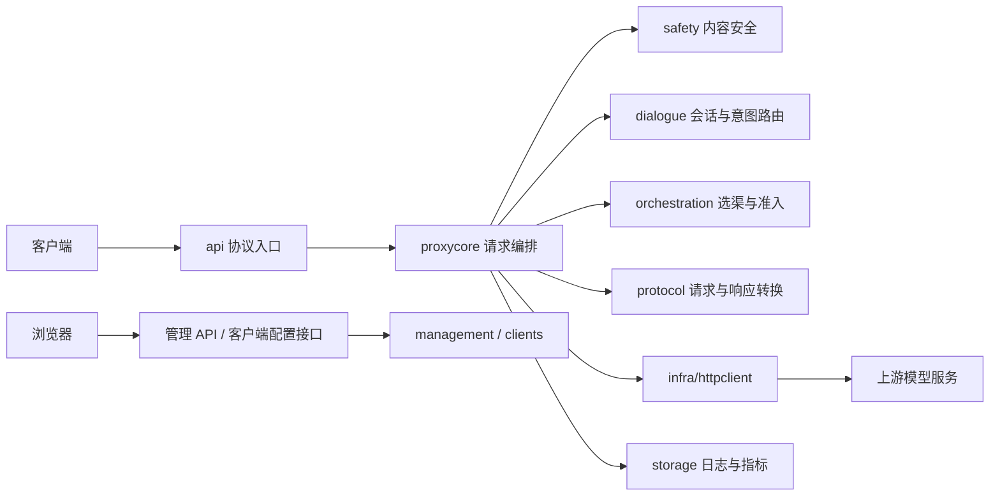

# 架构说明

Go 后端与 Vue 管理台共用一个进程、一个端口（默认 3000）。前端静态资源在构建时嵌入二进制。后端目录职责见 [后端约定](../backend-go/AGENTS.md)，前端目录见 [前端约定](../frontend/AGENTS.md)。

## 请求经过哪些模块

cmd/server 负责依赖装配、路由和生命周期，其中 main.go 是进程入口，app.go 装配运行组件，app_routes.go 注册路由，app_lifecycle.go 管理停机。api 处理 HTTP 与协议差异；管理接口按会话、扩展、意图、日志、安全和设置分包。通用请求流程由 proxycore.RunProxyRequest 编排，差异通过 ProtocolSpec 注入。安全、转换和调度组件不反向依赖 HTTP 接入层。

newApp 按配置与日志、用量记录、存储、调度、安全、客户端和 HTTP 路由分步装配。技能翻译适配、画像初始化和安全历史清理分别由所属模块提供入口；渠道集合从配置字段映射导出，调度器按 ChannelKind 接收指标管理器，避免依赖位置参数表达协议关系。

客户端配置接口集中在 clients 顶层，各客户端的 `*_edit.go` 编排保存；filetxn 子包统一真实路径身份、修订比较、唯一备份和部分提交结果，底层替换复用 storage/atomicfile。piagent、mcpsync、skills、extensions 子包均不依赖 HTTP。进程内文件锁协调本项目的各写入入口，替换前再次核对内容；它不等于与外部客户端共同持有跨进程事务锁。

MCP 适配器通过条目编解码、合并和替换能力支持开关与接管，服务层持久保存每个目标的提交前后指纹，删除分发失败后仍可重试。Skills 将启用清单与本机托管记录分开，安装先暂存全部目标，记录意图后发布；关闭只移除本项目托管且未被本地修改的副本。项目来源未完成发布时暂停该技能的自动分发，提示重试原操作。列表保持只读，旧备份恢复由“导入现有”显式触发。

扩展目录迁移先复制、校验并同步完整目标，持久记录 copying / publishing / prepared / configured / complete 阶段；配置切到完整目标后才清理源目录。源清理失败保留活动目标和恢复记录，管理页可查询阶段。Git 推送预览完整文件清单并校验修订号，仅暂存 Skill 资源及启用清单；本机 MCP、托管状态、元数据和翻译备份不导出，待推送历史中的非导出文件也会阻止推送。远程技能安装必须匹配预览 commit，缓存失效后要求重新预览。

前端的 app 组合业务流程，features 各自拥有视图与服务，通过少量公开出口协作；shared 提供通用能力，types 保存契约。

管理台认证把待验证凭据与已验证会话分开，仅保留 `api-proxy-auth` 一个存储入口；旧 `proxyAccessKey` 成功迁移后删除。更换凭据、注销或当前会话 401 会取消该代请求，由 app 清理受保护 Store。普通管理读取有 30 秒期限，写操作和流式任务采用各自策略；JSON 管理接口拒绝坏 JSON、HTML 和非 204 空体。跨标签页凭据变化要求重新验证，旧请求不能注销新会话或回填旧数据。

草稿离页与浏览器关闭保护复用 `DraftGuard`，`useDraftSnapshot` 维护保存基线；客户端提示词卡片向父页面汇报草稿和忙碌状态。保存期间锁定编辑区，`ApiError.committed` 通过 shared 的 `apiErrorText` 明确提示已写入及核对要求。MCP 的纯表单映射留在本 feature 的 `utils/mcpForm.ts`；Skills 单项翻译请求与四协议完成判断放在 `services/translation.ts`，SSE 按完整事件解码，异常、截断或取消只保留草稿。单项翻译随页面及认证取消，批量翻译仍是后端任务。

渠道编辑携带 `expectedChannelId`，配置层在同一写锁内核对下标与稳定 ID；不匹配返回 409。会话固定路由保存 `channelId`，调度按稳定身份解析当前下标；旧记录缺少 ID 时要求重新选择，不按旧下标猜测目标。渠道数组重排后仍指向原渠道，原渠道消失时明确失败。

模型指纹检测通过管理鉴权下的 `POST /api/channels/:id/fingerprint` 创建后台任务，`:id` 为稳定渠道 ID；`GET` 同一路径查看最近一轮任务，`DELETE /api/channels/:id/fingerprint/:taskId` 显式停止指定任务。management/modelfingerprint 固定渠道快照、实际 URL、Key、模型与思考档位，直接构造原生文本请求；不进入 proxycore、意图匹配、模型映射、历史会话、安全处理及提示词改写。传输仍遵守渠道代理、TLS 和共享准入，客户端身份沿用快捷测试使用的 Codex / Claude Code 伪装函数（包括必要的 Claude 计费标记）。采样失败不更换目标，也不跟随 HTTP 重定向。任务独立于管理连接，关闭弹窗或刷新页面不取消；每渠道最多一个运行任务，全局最多 4 个；任务文件按同一渠道串行写入，落盘不占用全局状态锁。任务状态与保留策略分别在 `jobs.go`、`jobs_retention.go` 中维护；内存最多 128 份，当前格式的磁盘任务按 256 份和 30 天清理，运行中任务受保护。每次补测均核对当前配置摘要。整轮限时 10 分钟，进程停机先取消并等待任务退出。参考库和最近一轮任务保存在启动工作目录的 `.config/model-fingerprint/`，结果不保存凭据；重启后未完成任务标记中断，不自动重发。检测结果来自 lm-detector 的参考库内统计排名，不作为模型身份认证。

`POST /api/channels/:id/fingerprint/:taskId/retry` 补测原任务内失败、截断或已停止的样本；`POST /api/channels/:id/fingerprint/:taskId/samples/:sampleIndex/retry` 仅重试指定失败样本（序号从 0 开始）。两者沿用原任务和挑战，保留成功样本；批量补测中某条再次失败仍继续尝试其余失败项，全部尝试后重新计算一次整轮排名。禁止重试进行中的任务或成功样本，无失败项时显式返回错误。凭据只保留在进程内快照；重启后按已记录目标及配置摘要核验后恢复，参考库构建时间、数据 SHA-256、评分器摘要或已记录 SDK 版本变化则拒绝混合重试。项目下载层校验参考包和完整评分数据的摘要，再交给 SDK 加载；更新 SDK 时须同步核对参考包布局与格式。操作说明见 [开发说明](开发说明.md#渠道思考控制)。

前端基础控件位于 `shared/ui/`，通用组合组件位于 `shared/components/`。`shared/theme/` 把浏览器主题偏好应用到 `html`，页面、浮层和图表共同消费 `styles/theme/` 的令牌。目录职责和扩展方式见 [前端设计系统与主题](前端设计系统与主题.md)。

## 协议与渠道

协议转换分为公共契约、纯映射和 HTTP 交付三层。`protocol/contract` 统一校验工具参数、跨协议能力、完整响应结构和终态；普通响应必须带有效结束原因，流式中间帧允许暂缺终态，最终完成仍由源协议事件确认。无法表达的内容返回明确能力错误，不静默丢弃或改成成功。

Messages 支持 Claude Code 在 `messages` 中发送文本 `system` 消息。原生 Claude 保留消息位置与块上的缓存标记；转 Chat 和 Responses 时保留位置，分别映射为 `system` 和 `developer`。Gemini 通过 `systemInstruction` 表达系统指令，顶层指令在前，消息内指令依出现顺序追加，不重复纳入 `contents`。跨协议转换不传递 Claude 专用的缓存标记；消息内的系统文本也纳入请求内容安全检查。

`protocol/converters/togemini` 提供普通响应映射和 Claude/Chat 流式状态机；文本、工具累积、用量和停止原因在协议层处理，API 共用读取、取消、安全检查、还原及写回流程。`protocol/converters/toimages` 集中 Images→Responses 请求映射、图片参数校验和 Responses→Images 输出合并；渠道模型解析及 multipart 读取留在 API。Responses 动态工具的映射由本次实际候选请求携带到回程，覆盖会话恢复的工具定义，避免只凭本轮原始正文猜测工具类型。

| 类型 | 入口 | 行为 |
|---|---|---|
| 五类编排协议 | `/v1/messages`、`/v1/responses`（含 compact）、`/v1/chat/completions`、`/v1beta/models/*`、`/v1/images/*` | 统一选渠、重试与安全处理，按上游能力转换 |
| 原样透传 | `/v1/embeddings`、`/v1/decisions` | 路由到对应上游，保留请求与响应格式 |

ChannelKind 表示 messages / responses / chat / gemini / images / embeddings / decisions 七类入口分组；ServiceType 表示上游实际协议。Images 支持原生 Images 上游与 Responses 生图上游。

渠道的 `maxBranchConcurrency` 默认 3，只接受大于零的安全整数；旧配置未提供时自动采用默认值。卡片显示“当前分支并发 / 上限”，点击数字后可输入，失焦或 Enter 保存，也可在渠道编辑的“连接与并发”中设置。后端在渠道请求准备前原子检查并登记，同分支重复请求共用额度，结束时幂等释放；调低上限不取消已有处理。自动选渠遇到满额渠道时按原有分组与优先级尝试下一渠道，容量跳过不依赖 Fuzzy，不影响渠道健康；真实上游失败仍遵守原有 Fuzzy 重试规则。显式指定渠道、固定路由及非 Fuzzy 的显式映射目标不绕过其限制；没有可用额度时返回 HTTP 503、`channel_branch_capacity_exceeded`。这一上限与 URL / 协议 / Key 共享的 `maxConcurrency` 请求上限独立。内置免费渠道通过 `freeChannels.kilo.maxBranchConcurrency` 保存共享设置，`PUT /api/free-channels/kilo` 可单独更新它，四个入口使用同一配置值、各自按渠道计数。

渠道卡片的“并发”按稳定渠道 ID、内部会话 ID 与分支身份去重；同一分支的并行请求和重试使用引用计数，最后一个请求结束后释放。分支身份独立提取通用 `Thread-Id` / `X-Thread-Id` / `Thread_id`、`Branch-Id` / `X-Branch-Id` / `Branch_id`、`Agent-Id` / `X-Agent-Id` / `Agent_id` 请求头，以及请求体、`metadata` 和结构化 `metadata.user_id` 中的 `thread_id` / `branch_id` / `agent_id`（兼容 camelCase）；同时识别 Codex 的 `X-Codex-Turn-Metadata.thread_id` 与 Cursor 的 `X-Cursor-Agent-Id`。优先使用请求头，随后使用元数据补齐；父节点、轮次、请求 ID、缓存键和显示名称不作为分支身份。已有会话标识保持原归组；仅提供通用线程请求头时，以该线程建立稳定会话。多层分支按各自稳定身份统计，无须完整父子树。仪表盘同一快照返回 `activeConversations`、`activeBranches` 与 `unidentifiedBranchConversations`；没有分支标识时按会话去重，同一会话的无标识请求不会在已识别分支之外额外增加计数，并明确提示统计可能不完整。计数只覆盖渠道处理期间，不推断客户端本地工具执行时的活动状态。

渠道允许全部删除。删除自定义分组时会一并删除其全部渠道（包括暂停、备用、弃用及纯图片理解渠道），由后端原子提交。渠道与分组的 `GET /api/{kind}/channels/{id}/deletion-impact`、`GET /api/{kind}/pools/{id}/deletion-impact` 返回删除范围及图片理解引用渠道，供组件确认框展示；预览不修改配置。删除时按最新配置关闭引用方的图片理解支持和图片理解层，清空图片理解渠道与模型选择，与删除一同提交；写入失败保持原配置。兜底分组与内置免费分组不能删除，被意图路由引用的分组须先解除意图引用。

内部意图分类和命令闸门可通过 Decisions 调用结构化辅助问答；systemone 只保留为旧配置别名，不请求 `/v1/systemone`。这不约束对外 Decisions 透传的载荷格式。

## 上下文压缩与文本摘要池

渠道详细设置的“上下文压缩”分别控制提供摘要能力、委托摘要池和原生压缩模型。默认不分流、不替换模型。将辅助渠道加入文本摘要池后，填写其实际摘要模型；该渠道退出常规对话调度。同入口协议的主渠道打开“将独立摘要委托给文本摘要池”后，按辅助渠道优先级尝试，支持通过现有转换器连接不同上游协议。池为空或耗尽时返回 `COMPACTION_UNAVAILABLE`，不会静默回到昂贵主模型。无需固定渠道引用，删除摘要渠道后按最新池成员调度。

`X-Api-Proxy-Task: compact` 是本网关约定，表示客户端已经将待压缩历史序列化成独立文本。可用于 Messages、Responses、Chat、Gemini；不接受工具续轮、服务端历史引用、图片或签名块。原生控制信号优先于这个任务头。可选的 pi 模板适配只识别完整系统提示词与单个 `<conversation>` 文本输入，不按“总结”等关键词猜测；模板变化或其他客户端需显式标记。可直接使用客户端自身的摘要模型配置时，也可以由客户端选择便宜模型。

原生识别覆盖 `/responses/compact`、Responses `compaction_trigger`、Claude `compaction.type=summarize`；`context_management` 压缩策略仍是可能继续工作的普通请求，不进入摘要池。`compaction` / `compaction_summary` 历史重放只标记历史边界。原生请求和压缩历史保持原生协议，禁止跨渠道模型映射与删除签名重试。独立原生压缩可配置精确的“主模型 → 压缩模型”，要求同渠道单地址、单密钥，并由管理员确认完整往返兼容；同协议或同名模型本身不能证明加密状态或思考可移植。自动压缩及后续续聊不应用该模型替换。

独立摘要复用鉴权、安全管线、上游并发准入、熔断和用量记录，不更新主会话轮次、模型亲和、Responses ID 或缓存保活。原生压缩仍使用既有会话版本事务，失败保留旧历史；完整压缩输出按原顺序提交，`compaction_trigger` 不进入保存的历史。已开启意图路由时，压缩执行模型写入事件，主会话来源保持续聊模型。请求响应头 `X-Api-Proxy-Compaction` 和日志详情显示分类；`X-Api-Proxy-Compaction-Route` 显示 `source`、`summary_pool` 或 `native_model`，实际渠道、模型与用量沿用尝试日志。

Claude `usage.iterations` 按迭代合计计费，避免与顶层字段重复相加。客户端的顶层零值及压缩后窗口大小原样保留，不以旧历史的本地估算修补。流式迭代按累计快照替换，重复 SSE 事件不会重复累计。

厂商兼容性需要实际验证“主模型生成历史 → 压缩模型压缩 → 主模型继续工具/思考调用 → 再次压缩”。代理无法验证或重建加密内容；配置确认不等于网关已经验证厂商支持。摘要质量、保留尾部和历史切点由客户端与厂商协议决定。

## 缓存保活

渠道卡片仅在已开启保活、且存在已保存上下文并正在等待或发送心跳的会话时显示跳动爱心；达到限制、取消或停止后隐藏。仪表盘通过 `activeKeepaliveSessions` 随原有轮询返回活动会话数，每轮只扫描一次保活元数据，不读取正文或逐渠道额外请求。悬浮才读取该渠道的会话详情，展示 `snapshotAt`（实际生成冻结上下文的时间）、`nextHeartbeatAt`（下一次心跳时间）、次数与停止原因；打开期间每 10 秒刷新，关闭时取消请求。准备快照、检查期限与真正发送心跳分别展示。

渠道的 `cacheKeepalive` 默认关闭，需要明确会话标识，快捷测试不触发。支持范围与现有对话入口的转换能力一致：Messages / Responses 均可连接 Claude、OpenAI Chat、Responses、Gemini；Chat 仅连接 OpenAI Chat；Gemini 可连接 Gemini、Claude、OpenAI Chat，共 12 条路径。Images、Embeddings、Decisions 和内置渠道不参与。保活按转换后的实际上游协议处理，不再次执行选渠、模型映射、视觉转译或历史拼接。

`proxycore` 在实际发送时登记最终正文的只读引用；每会话仅保留最新候选，不在每次请求中复制、解析或序列化历史。任务键由调用方作用域、客户端类型、明确会话 ID 和 Agent ID 共同确定；同一渠道的不同会话独立保存正文、计时和计数，新请求只重置所属会话。请求按到达顺序区分代次，旧请求晚结束不能覆盖新候选。同一会话全部在途真实请求结束且空闲一分钟后，`orchestration/cachekeepalive` 才读取正文、检查新增心跳内容并生成冻结快照。后续心跳始终使用同一快照，不累计心跳消息和回复，不写入真实对话。保留实际 URL、Key、模型、前缀、工具定义、思考参数、缓存键和流式选择；JSON 与 SSE 分别解析真实用量，截断、错误事件和不可信缓存计数明确停止。

间隔最少 180 秒，默认 280 秒；首次心跳或显式缓存续期均等待真实请求结束后空闲满间隔，后续从心跳发送或资源检查时刻计算。缓存窗口始终从最近实际上游发送时刻检查，若真实请求耗时已使下一次心跳错过窗口，则停止。Claude 显式断点使用最短 TTL，OpenAI 隐式缓存按保守的 5 分钟窗口或已声明的 `24h` 保留策略检查，已知窗口至少预留 15 秒；Claude 兼容服务和 Gemini 隐式缓存没有固定窗口时，仅按实际命中反馈判断，不保证服务端缓存不会被提前淘汰。按配置的次数或持续时间停止，同时设置时任一达到即停止；只按次数时不另加整轮时间上限，累计 Token 仅用于统计，不作为停止条件。缓存读取占比、绝对命中量相对真实请求低于配置比例（默认保留至少 90%），或缺少可信用量、上游繁忙、冷却、发送失败时也停止，不重试、不切换目标。原请求新建缓存 Token 纳入预期可命中前缀。Claude 的空历史处理配置，以及 `clear_thinking_20251015` 的 `keep: "all"` / `keep: {"type":"all"}` 原样保留，空 MCP 列表和 null 容器不阻止保活。思考预算不适配输出上限、实际服务端工具、清理或压缩历史的策略明确跳过，并按具体原因展示。传输复用共享准入、代理和 TLS，仅在目标空闲时准入，最多两个后台工作线程。全局配置版本只发出检查通知，按目标与安全策略摘要决定是否失效，无关渠道修改不清除已有候选；响应复用公共 SSE 与停止原因契约，缺少终态或空 choices 不能记为成功，合法输出上限仍可接受。

Responses 心跳保留固定 `previous_response_id`，设置 `store:false`、`background:false`，不更新网关的 Responses 链或会话记录；可变的服务端 `conversation` 会自动追加共享历史，因此明确拒绝用于保活。Gemini 原生入口保留 `cachedContent` 引用，引用不能跨厂商转换。显式 `cachedContents/*` 资源通过同源资源接口读取 `name,expireTime` 并 PATCH 到期时间，不调用模型；核对资源归属与返回期限，已过期不重建，原期限更长则不缩短。进程内同一资源的读取及更新整轮互斥，重复任务停止。配置了持续时间时，续期目标不得超过本轮截止时间；每轮检查及续期计一次。资源保留会产生上游存储费用，手动停止不会缩短已存在的期限。无法从实际上游端点安全推导资源地址的请求明确停止。

全局最多 512 个会话、64 MiB 快照记账预算，原始正文最多 2 MiB；临时解析内存受固定工作线程数约束，预算不代表整个进程的内存硬上限。每会话最多一个到期项，每 30 秒清理过期引用，停止状态最多保留一小时。建立候选时再次校验次数和持续时间至少有一个上限，调度及执行前均检查停止条件，发送层同步执行整轮截止时间；无法确认发送及有效时间时停止，避免重复发送。新真实请求、所属目标的有效配置变更、删除会话和停机取消旧任务；无关渠道修改不使全部保活失效，促销计数和历史 Key 同步不触发失效。旧任务晚返回不会覆盖新状态，其仍持有的正文计入预算直到退出。上下文不落盘，重启不恢复付费保活。

管理鉴权下的 `GET /api/channels/:id/cache-keepalive` 返回入口/上游协议、缓存方式、状态、基线和最近命中率、Token 累计、最近/下次时间、显式资源到期时间及全局容量拒绝次数。`POST /api/channels/:id/cache-keepalive/stop` 接收 `{sessionId: "状态中的 id"}` 停止单会话，空 ID 停止整个渠道；停止不允许在途旧结果重新激活，新真实请求可开启下一轮。管理台每 10 秒刷新可见页面，支持单会话及全渠道停止。保活生成用量以独立 attempt ID 和 `cache_keepalive/实际上游协议` 进入已启用的用量手账；已返回的可信用量即使伴随发送失败或任务取消也记账，缺失用量明确标记。普通请求指标不计心跳，运行日志保留保活结果和停止原因。

## 主请求流程

鉴权与读体 → 安全处理与会话识别 → 选组、选渠 → 构建上游请求 → 共享准入 → HTTP 发送 → 响应转换 / SSE 转发 → 关闭响应体、释放许可、记录日志和健康结果。

- 正常选渠遵循配置顺序；促销只在同组生效，会话绑定优先。按次数促销（含同时设置时长）只在当前进程内计数，重启后结束，成功请求不再写配置；纯截止时间促销仍持久化。性能画像只供观测。
- 分组按路由顺序逐个完成健康筛选、恢复探测与正式熔断准入；命中分组全部熔断或探测名额已满时继续兜底分组，组内仍可探测时不提前跨组。固定渠道只约束目标，仍须取得熔断许可，失败时明确报错。
- 共享准入按解析后的上游服务地址、协议、Key 聚合；自动补版本与完整端点的等价写法、默认端口共享并发和冷却。自定义路径、查询参数及非默认端口保持区分。
- 重试受发送次数和累计排队预算限制。流已交付后不能当作完整失败重新发送。
- 意图路由共用预览与实际决策快照；驻留、工具续轮、加密历史和人工固定具有保护规则。免费组需配置能力且服务启用才参与自动选组，不新增跨组故障转移。
- 意图准备任务属于服务生命周期，管理连接关闭后继续下载、预热与构建索引，停机先取消并等待再关闭本地助手和存储；准备结果须在管理台显式保存。已保存策略依赖本地模型时重启自动预热。资源由内置清单锁定内容摘要，优先本仓库 latest 固定附件，备用上游固定版本，缓存与离线导入均校验同一 SHA-256。类别纠正只生成待审核样本，独立评测与在线分类共用拒识规则。
- 流式处理传播请求 Context，客户端断开或处理结束时关闭上游 Body。

`api/streams` 提供公共响应体转发与 SSE 交付，协议入口传入完成判据；Messages 专用的事件、用量、安全回灌和日志位于 `api/streams/messages`，父包不反向依赖子包。公共 `protocol/codec` 以空行划分 SSE 事件，把多个 data 行合成一个载荷，并保留原始事件及读取错误；任意网络分片不改变协议语义。EOF 本身不代表完成。原生 Images 按最终出站请求的图片数量判断完成。Responses 生图接入通用 Responses 交付和历史提交，使用 `response.completed` / `response.incomplete` 的终态语义；图片结果及未知字段可落盘并用于后续恢复。Responses 除逐事件读取外，还持有本轮输出及会话历史，含大图片时的内存不能描述为仅随单个事件增长。图片转换写入器独立于转换循环，所有交付错误显式传给编排层。

`infra/httpclient` 按客户端缓存、传输与超时、发送准入、响应体释放和观测分文件。调用方通过 `ClientOptions` / `SendOptions` 传入配置快照，不读取进程级全局网关设置。缓存按最近使用顺序最多保留 128 组客户端，淘汰及进程停机时关闭空闲连接；在途请求继续完成。

共享客户端直接返回 3xx，不跟随重定向，避免正文和上游凭据被转发到其他地址、实际目标绕过准入身份；依赖跳转的渠道须改为最终接口地址。发送层不按 TLS 错误文本隐式重放请求，重试由编排层决定。普通请求保留整体超时；流式响应头阶段预算包含连接、上传和等待响应头，从取得准入名额后开始，收到响应头即停止，后续正文由空闲超时和客户端取消控制。

上游身份由 `infra/upstreamreq` 复用 URL 拼接规则解析协议主端点，`orchestration/upstreamcontrol/identity.go` 负责主机与默认端口归一化、凭据摘要和持久化指纹；控制器负责队列和名额，`request.go` 负责请求预算，`cooldown.go` 负责共享冷却策略和只读快照。新增协议时需登记其主端点与明确共享额度的操作。队列在取消、超时、放行或配置移除后清空对应引用，空队列释放底层数组。

身份指纹使用新的版本域，旧版按原始 BaseURL 计算的归属不会被猜测为新身份。Responses 遇到归属不匹配时，沿用本地历史恢复流程：历史完整则移除旧 previous_response_id 后发送完整输入，历史缺失则明确要求客户端重新提供完整对话。可用性观测按新身份重新积累，旧样本仍保留在存储中。

可用性观测与免费选模共用结果分类；本地意图状态保存失败归为排除样本，不污染上游失败率。发送准入的共享凭据冷却由 upstreamcontrol 执行，管理台读取其当前截止时间，跨模型共享且不会被在途成功或较短 Retry-After 提前清除。免费选模将这类等待交给发送准入，不用历史冷却估计排除模型。只有明确的模型容量错误且上游提供有效 Retry-After 时，才按模型记录冷却并过滤候选；缺失或无效值不补造 30 秒等待。两条路径复用 Retry-After 解析，秒数从收到响应头时起算。旧观测中的估计冷却不再用于控制请求，原始样本仍保留。

URL 健康由 `orchestration/urlhealth` 管理，只调整尝试顺序，不禁止尝试候选。地址达到连续失败阈值才降序；未达阈值按当前配置顺序，达到阈值后按冷却状态与失败次数排序。修改地址列表时按 URL 保留仍存在地址的健康记录，候选索引重新对应本次配置；单地址和空列表也同步状态。

主请求、内部文本调用和图片理解共用 `infra/upstreamreq` 的地址故障判定。HTTP 认证、配额和请求拒绝，以及结构化错误码明确的模型、凭据和限流错误，不计为地址故障；408、未被业务错误解释的 5xx 和未知的 2xx 错误信封才计入。网络和读体失败由调用方单独记录。结构化错误分类同时供可用性观测使用，避免各调用链维护不同的错误码表。

调度器按 `selection.go`（分组与选渠）、`permit.go`（准入许可与预留释放）、`circuit.go`（熔断查询与适配）分文件维护。固定渠道、模型映射和图片理解渠道复用正式准入入口；列表候选在实际尝试前通过 AdmitChannelCandidate 取得许可，预检不能替代正式占位。模型映射不声明模型支持范围，未匹配时仍允许按原模型透传，不将映射结果当作能力过滤。

图片理解在 safety/visionlayer 内按请求准备（vision_layer.go）、渠道轮询（vision_channels.go）、分析缓存与许可收尾（vision_analysis.go）、上游调用与观测（vision_attempt.go）、响应解析与分类（vision_response.go）分文件维护。指定渠道、公共池和当前分组保持原有尝试顺序；错误是否可重试独立于单渠道失败次数上限，URL 的 Key 排除记录不跨地址复用。每次渠道调用通过 defer 按实际结果记账并释放许可，缓存命中、取消、本地准入和限流按中性处理；缓存收集时取得的分析占位覆盖全部错误出口，等待者保留原调用的重试判断但不重复记渠道失败。

图片理解响应先严格解压，再检查 HTTP 状态与结构化错误对象，最后转换协议并验证停止原因和逐图结果。解压失败保留错误链，不将原始压缩数据交给协议解析；沿用原有 64 MiB 解压输出预算。HTTP 2xx 中的错误对象按业务原因决定重试，日志保留实际 HTTP 状态。限流直接交给下一渠道；请求内容拒绝和 refusal 不重试、不缓存，也不增加 Key 或渠道故障次数。截断、空结果和不完整的多图响应继续明确失败。

图片提取和写回复用同一组协议内容位置，覆盖普通消息、Claude 嵌套工具结果，以及 Responses 的 function_call_output / custom_tool_call_output.output；不遍历工具参数、schema 和 metadata。全部图片描述校验成功后再替换，缺失结果不会留下部分改写。最终上游请求明确声明非 JSON 媒体类型时直接跳过；JSON 或未声明媒体类型的对话请求必须是完整的单个 JSON 对象，格式、尾随内容或媒体类型错误明确返回。

图片缓存只保存成功结果，使用独立版本域、图片指纹、渠道及端点、解析后的实际模型和本次分析文本生成键；模型解析与发送使用同一渠道快照。修改模型映射或分析问题后重新识图，不读取旧规则的缓存结果。图片指纹出现过不代表解析失败过，首次或历史图片的识图失败都明确返回，不用占位文本掩盖错误。JSON 格式响应必须整体有效，数字分段按本批顺序映射并拒绝重复、越界与跳号；标准化响应明确标记为截断、拒绝或未完成时不落缓存。分析文本仍限制为末尾最多 2000 字节，但截断位置对齐 UTF-8 字符边界；不再单独计算未使用的意图指纹。

共享图片分析随发起请求取消；仍有效的等待者重新争取占位，以自身请求上下文接手，多个等待者继续合并为一次调用。等待者自身取消只结束自己的等待，真实上游失败保留原重试判断。内存缓存与持久层读取共用分析占位，清理单会话或全部缓存时同时移除相应占位；旧读写或上游分析返回后不能回填旧结果，也不能删除新占位。已开始的请求仍可收尾，持久化会话是否存在由 Registry 校验；缓存层通过仅含图片结果读写的接口访问持久层。

代码修改必须保留的具体约束见 [规范与不变量](规范与不变量.md)。

辅助资源统一由 `infra/httpclient.DownloadClient` 创建专用客户端，读取项目代理配置，允许有界 HTTPS 重定向，连接池由下载任务收回。本地向量回环请求仍明确直连。指纹 SDK 只使用本地加载入口；项目负责参考库下载、SHA-256 校验与原子持久化，SDK 不自行联网或刷新。Windows 在创建本地向量进程时将其加入关闭即终止的 Job Object；Unix 使用独立监督进程，宿主管道 EOF 触发回收，运行时控制只指向自身启动的进程。

安全数据集评测与线上共用 `semantic.AssessSafety`，按工具作用域召回风险并取同类最高反例，差值和已审核正则决定 `blockEligible`。评测的 mode 为 `safety_retrieval`，评估当前数据集全部标签；该统计不是 AI 闸门最终阻断准确率，实际行为还取决于启用规则和模式。森林对满批积压按每轮最多 16 批／250 ms 连续追赶并让出执行机会，通过已有 catchingUp 状态展示，事务游标及结算日规则保持一致。

## 会话与协议历史

`dialogue/conversation` 管理客户端身份、对话观测、人工路由及查询；`dialogue/session` 管理可恢复的 Responses 历史、版本及 response ID 归属。前者按观测、控制操作、图片存储、保留清理和生命周期协调分文件；后者以 `Turn` 表达一次请求的历史快照和在途租约。两层持久化必须借用同一个 SQLite 连接对象。生命周期绑定先完成清理再发布，失败保留原绑定。

Responses 入口在首次上游尝试前 `BeginTurn`，所有故障转移候选使用同一开始版本；请求结束释放租约。普通、流式、图片工具及 compact 共用提交入口。历史在锁外编码并复制，发布的状态不保留输入或请求快照的嵌套引用；提交按期望版本更新；同一父历史的并发响应各自保存为分支，不因另一请求先完成而失败。每个 response ID 记录正文边界，读取旧 ID 恢复对应前缀；普通续轮只增加边界元数据，只有分叉才另存完整历史。已删除的会话仍拒绝晚到写入。正文、访问时间、response ID 映射、上游凭据归属与 Registry alias 在同一事务提交，重复 response ID 不覆盖原归属。显式身份按协议、原样 ID 和 Agent ID 分量编码，保留 ID 大小写；匿名重试只有唯一候选才继承对话。

普通响应和流式成功终态在历史提交成功后交付。本地保存失败保留已获得的用量，通过本地响应错误返回，不重发上游或处罚 Key。客户端在完整工具交付后取消时，仅提交已交付的连续完整前缀，并使用最多 10 秒的独立收尾上下文；正常读写、锁等待和图片缓存访问沿用请求 Context。`dialogue/internal/syncstate` 只供会话内部使用，不向其他业务推广通用锁框架。

`protocol/items` 的 Responses 收集器按 output item、content part 和 summary part 独立归并，校验索引及身份冲突，允许 ID 晚到；done 快照覆盖实际字段，明确的空终态 output 也是权威结果。终态缺少 output 时只使用已经完成的条目。普通响应和 SSE 终态共用可恢复输出规则：截断文本可以保留，未完成工具及其后续条目不进入历史。`protocol/types` 保留未知原生 item 字段，请求 input 及 SSE 未知数字不先转为 float64；转换路径不能伪造空工具参数。历史只在明确 compaction 边界切根，去重必须证明完整前缀或带稳定身份的完整尾部，不能按角色、条数或正文形态猜测。

Registry 的人工修改先保存候选再发布；请求观测保存失败恢复原状态。收尾观测暂存 dirty 状态并公开 `PersistenceError`，后台每 5 秒有限重试，停机报告未保存错误。待保存或在途的不同记录最多 256 个，同一已在途记录不重复占名额；查询先确认待保存状态可同步，再按数据库分页，活跃 ID 查询不加载正文。提示记录只规范换行和首尾空白，名称及错误按 Unicode 字符截断，不根据标签猜测并删除用户正文。

删除、全删和 Registry TTL 清理由共同事务协调历史、映射、别名、父子关系与图片结果，提交成功后才失效内存。Session 清理覆盖冷热历史且保护在途租约；过期历史不会通过读取重新续期。装配层为 Responses 链、Gemini shadow 和 reasoning 缓存登记统一失效回调，删除、TTL 与停机都会释放缓存。请求租约在回填时检查原对话仍存在且未停机，晚到结果不能重新创建已删除状态；Responses 链同时使用真实过期回收和容量淘汰。完整历史复制、写放大与缓存字节预算仍属于独立性能问题，需要测量后处理。

## 数据与观测

后台资源与观测约束：指标通过唯一写入循环与合并唤醒落盘，待写和在途批次共同受 4096 条／8 MiB 估算预算约束；写入失败回填并限速，最终失败通过 Close 返回，删除前刷新失败则不执行删除。性能画像使用协议与稳定渠道 ID，凭据仅保存摘要；最多 4096 个画像，空闲 24 小时或配置已失效时回收，保护在途请求。会话亲和的两个提示缓存各最多 4096 条，字段最多 4096 字节，满时淘汰最久未写入的提示，不删除会话历史。

配置加载和管理写入都会调用候选校验，再原子保存并发布快照。目前覆盖全局设置和部分协议、引用约束，各渠道入口的字段检查尚未完全统一；加载仍有旧格式迁移与归一化，不能等同于严格 schema 校验。模型映射仍引用某渠道时，须先解除映射才能删除目标渠道。伪装设置变更通过专用合并通知交给唯一的版本同步任务。

历史 Key 在启用指标持久化后由指标库保存。变化时先将完整历史 Key 快照及 `historicalKeysPending` 标记随配置原子提交，再同步指标库，成功后移除磁盘中的历史 Key 和标记。同步失败返回 `committed: true`，后续保存或重启按完整快照继续恢复，不能将旧数据库合并回待同步快照；指标持久化关闭时仍随配置保存。该流程保证中断可恢复，不承诺文件和数据库之间的原子事务。

运行数据放 `.config/`：config.json 保存配置；SQLite 分别保存日志、拦截与审核、会话、指标、脱敏映射；master-key 保存脱敏主密钥。该目录不可入仓。

内容安全由独立的 contentSafety.enabled 总开关控制，默认关闭；缺少该字段也按关闭处理，不从子规则推断开启。关闭时保留规则配置，不绑定检测、脱敏映射或审批状态。开启后在请求绑定管线时固定设置快照，输入检查、响应检查及流式检查沿用同一份设置；启用脱敏规则且处置模式为 mask 时才绑定持久映射库。开关切换作用于新请求。占位符还原未命中时，使用当前请求的协议、渠道、模型及请求和会话标识记录审计；映射读写或审计失败显式返回错误。

可逆脱敏先提取协议正文与工具业务字段，保留字段名作为检测语境；全部规则完成后，再把本请求和授权会话中已知的原值覆盖到全部受检片段，避免敏感值换语境或出现在较早历史中漏检。工具说明可改写；数字、对象键、schema 枚举/默认值及签名绑定文本命中时阻断。嵌套 JSON 字符串在值替换后由内向外序列化，不能直接替换转义后的整段参数。新占位符使用中性的 `MASKED_<TYPE>_<TOKEN>_END`，兼容旧 `_PRESERVE_EXACTLY`，不添加系统提示或恢复指令。

跨请求恢复要求代理鉴权密钥与稳定的显式 conversation/thread/session 标识共同确定范围。仅有 `previous_response_id`、窗口标识或缓存键时不授予历史恢复权限；只使用当前请求重新识别出的映射。原加密映射表保留，新建会话授权表；旧映射须通过重新识别原值取得该会话授权，不能凭占位符查全库。共享代理密钥不构成多租户认证边界。请求级映射不按条数或原文大小拒绝内容；全库会话与授权各有 100000 条存储上限，达到上限明确失败。映射沿用 90 天保留策略，读取授权映射不逐条刷新访问时间；过期、清理或 LRU 淘汰会使关联会话不可继续按旧映射处理，需要用完整原始历史建立新会话。

检测快照使用两代有界缓存，仅保存文本摘要、规则与字节区间（每代最多 2048 条缓存/8192 个命中），不保存正文。旧代命中提升到当前代；身份证检测按 UTC 日期失效。审计复用凭据区间，每个请求仍保留独立审计记录；最多每 256 条或约 1 MiB 缓冲同步提交，写入失败阻断，不使用后台丢弃队列。已知原值覆盖始终重算；请求内改写缓存也校验映射代数。

映射库缓存最多 32 个会话，按估算内存 16 MiB 淘汰，固定 5 分钟到期并由每分钟清理回收引用；有效期也不超过其中最早过期映射。缓存暂存授权明文及替换表，落盘仍加密；Go 内存回收不承诺物理擦除。每轮通过数据库事务核对失效状态和授权版本，版本不变才复用；新增或撤销授权、修改密文、缩短有效期会失效。请求复制 map，共享不可变字符串和替换表，新映射使本请求替换表失效。关闭映射库时清缓存，不跨映射库实例共享。仍有全量 JSON 读取、摘要、已知值覆盖、映射写入和同步审计成本，不能宣称只处理新增消息；命令 AI 审核属于独立延迟来源。性能效果需以真实历史长度及并发基准验证。

内容安全设置突出个人信息、凭据和危险命令；关闭的规则组折叠，白名单、放行字面量及自定义规则放在高级区域。总开关与处置模式独立：开启内容安全后，按个人信息、凭据、自定义规则及危险命令的各自开关执行；处置方式可选阻断或可逆脱敏。关闭总开关不清空子规则或 AI 审批配置，未完成的草稿可保存，再次启用时完整校验。敏感词不再提供管理台开关，旧配置启用时明确提示；启用内容安全并保存本页时关闭旧敏感词检测，总开关关闭时保存仍保留原配置，后端保留旧接口兼容。危险命令只检查支持的执行工具；未启用 AI 闸门时命中直接阻断，启用后 AI 判安全立即交付，判危险才等待人工决定，超时或审核故障阻断。事后否决不能撤销已执行命令，也不替代 Agent 本机权限与沙箱。非流式拦截返回 403，流式发送协议错误与终止事件；客户端可能停止或重试，兼容性需逐客户端验证。

系统通知统一在消息中心选择关闭、仅命令审核、仅警告或全部消息；旧命令通知偏好继续按仅命令审核生效。新消息按范围发送浏览器 Notification，旧消息加载不重放；系统弹窗不携带正文或命令，点击回到管理台。必须使用 HTTPS 或 localhost、获得站点与系统权限，并保持管理台页面运行；页面关闭、休眠、后台节流、断网或勿扰模式下不能保证送达。没有后台 Web Push 或本地托盘服务；Go 服务端可能在远程主机或容器内，不直接向访问者桌面发通知。消息中心提供测试入口，失败可见，但 API 创建成功不等于操作系统一定展示。

流式请求通常是完整 JSON 上行、SSE 下行；请求侧在转发前完成检测，下行按逻辑字段保留占位符尾部。启用相关安全能力时，工具参数在完整校验后交付，未知或破损占位符报错，业务字段 name/id/type 正常恢复。工具参数、命令审核输入、流式交付及还原缓冲不设固定内容大小或事件数上限，不截断后放行；待审核内容越大，内存占用越高。审计批次阈值只触发同步刷新，单条较大记录直接提交。与标识符粘连的占位符不满足精确恢复边界时阻断；流式参数中的嵌套 JSON 或 Unicode 转义若无法保证增量还原与完整还原一致，也会阻断，可改用非流式请求。普通正文中的未知标记保留并审计。签名思考块不还原；签名工具参数需要改写时拒绝交付。该层不承诺图片/附件/OCR、编码或拆散的秘密、未知扩展字段、白名单放行内容及模型自行推断出的敏感信息得到全面保护，也不能让上游托管工具取得只保存在本地的原值。

Messages 流式转换通过同步交付向上游施加背压，避免在生产者与交付层之间堆积多个事件；单个事件和安全检查所需的完整工具参数仍按实际大小占用内存。上游未提供 usage 时，Messages 原生流不额外生成估算用量事件，指标保留未知用量。

logs.db 记录调用生命周期、尝试、工具关联与受限正文；正文按哈希去重。请求入口固定采集策略，运行日志、调用和正文分别设置保留期。存储预算是软上限，超预算时新请求降为元数据；写入拒收或失败会报告错误，详情超限返回 413。

观测只覆盖网关收到与发出的内容。上游状态、客户端 HTTP 状态和处理结果分别记录；流式 HTTP 200 不表示最终成功，工具关联不表示客户端工具已执行。

用量手账从管理台「用量」菜单启用，首次启用固定时区与记录起点。`/api/usage-journal/*` 走管理鉴权，提供状态、启用、按年日历与每日票据。代理尝试收尾分别向账本和运行日志交付结果。`usage-ledger.db` 的事实去重和小时、模型汇总在同一事务内完成。清理调用日志或渠道不会清除账本。估算与未知用量单独统计；明确的限流拒绝信封不制造用量缺口，拒绝响应若报告用量仍入账。超出本次输入总量的缓存明细不参与成长，账本保留本次输入总量。批满会唤醒写入器，成功后连续排空积压，失败会间隔重试。缓冲溢出、非正常退出及账本打开失败期间会留下覆盖缺口，打开失败通过 `.unavailable` 标记在恢复时补记。原生图片的非流式响应仅在账本启用后旁路采集用量，按块剔除长图片字符串，元数据缓冲有界，压缩数据流式解码，原始响应保持透传。原生 Images 与 Responses 生图 SSE 由交付层逐事件验证并读取上游报告的用量，解压后保留事件原文和未知字段；移除不再适用的实体编码及长度响应头。每日票据按去重后的事实与覆盖缺口计算版本，跨统计日才入账的事实会在原日期显示补记提示。[个人森林与用量手账方案](个人森林与用量手账方案.md)

森林从已提交用量游标读取上游报告的 Token，`management/forest` 将游标、三类成长、发现记录、奖励和布局提交到独立的 `forest.db`。基准暂时不可用时沿用已保存值并保留同步状态。积压消费在时间和批数预算内连续追赶，再让出执行机会；世界快照区分待同步与同步错误。每 96 棵树扩一座岛，每 8 座岛扩一片群岛。`/api/forest/*` 走管理鉴权，提供分层地图、按日种植记录、编辑、兑换和计时。计时命令检查状态版本，专注到期由后端入账，休息由用户确认后入账，Agent 等待独立记录。停机时先停止森林消费，再排空并关闭用量账本，剩余的已落盘用量在下一次启动时继续结算。

## 鉴权与停机

启动时由 `LoadEnvConfig` 读取并校验六项核心环境变量；缺失使用默认值，显式无效值停止启动。存在但无法读取或解析的 `.env` 也停止启动。`DefaultEnvConfig` 仅构造默认配置，运行请求使用已发布的设置快照，不重复读取环境变量。历史 Key 启动同步失败同样中止启动并保留恢复信息。

`/api/*` 和 `/admin/*` 路由组显式挂载 `AdminAuthMiddleware`，代理入口使用 `ProxyAuthMiddleware`。`WebAuthMiddleware` 处理 `ENABLE_WEB_UI` 开关，`/health` 始终公开。

停机先排空 HTTP 请求，再停止后台生产者，最后排空日志并关闭存储。后台生产者与存储分开登记，各阶段内部按登记顺序逆序清理，启动失败也遵循同一顺序；配置监听必须先于其依赖的历史 Key 指标存储停止。一项清理失败不阻断其余清理，错误统一返回。退出信号在启动阶段开始监听，HTTP 排空预算为 10 秒；首次终止信号后的完整停机最多 30 秒，第二次信号可立即结束；超时以失败退出，不在工作协程仍使用存储时抢先关闭数据库。命令审核的模型调用、否决监听和数据库收尾均登记到生命周期并等待退出。

## 设计决策

- **内嵌管理台**使代理和界面可以由一个二进制和一个端口交付。`RunProxyRequest` 将各协议共有的选渠、重试、安全处理和日志收在同一条流程中。
- **按实际凭据共享准入**使共用 URL、协议和 Key 的逻辑渠道共用并发上限，避免拆出多个渠道后叠加真实上游的负载。
- **保留用量观测**以便排查调用次数、Token、延迟和速率。网关缺少可核验的上游扣费凭证，因此移除了计费统计功能。
- **可逆脱敏**在请求中隐藏敏感值，并在响应中还原引用，让客户端可以继续使用原始内容。

版本沿革与功能变更见 [CHANGELOG.md](../CHANGELOG.md)。
