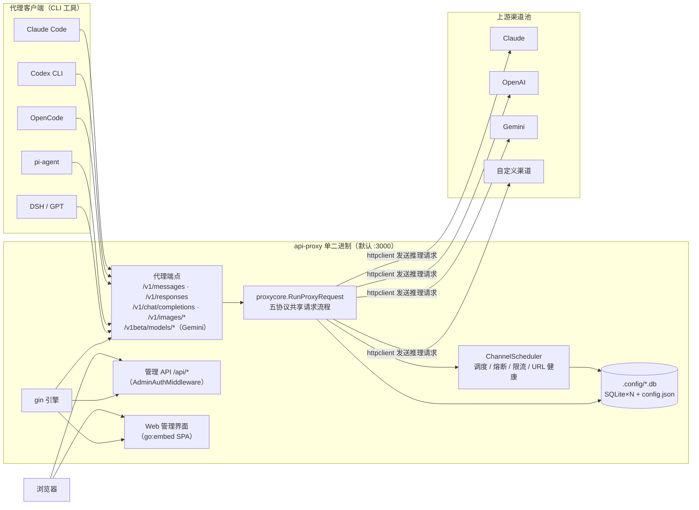
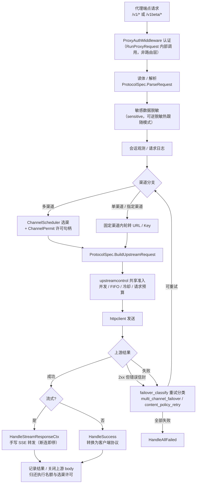
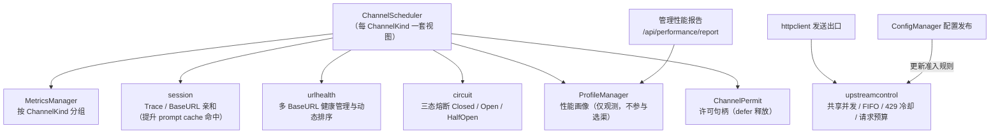
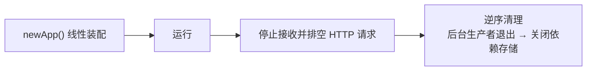
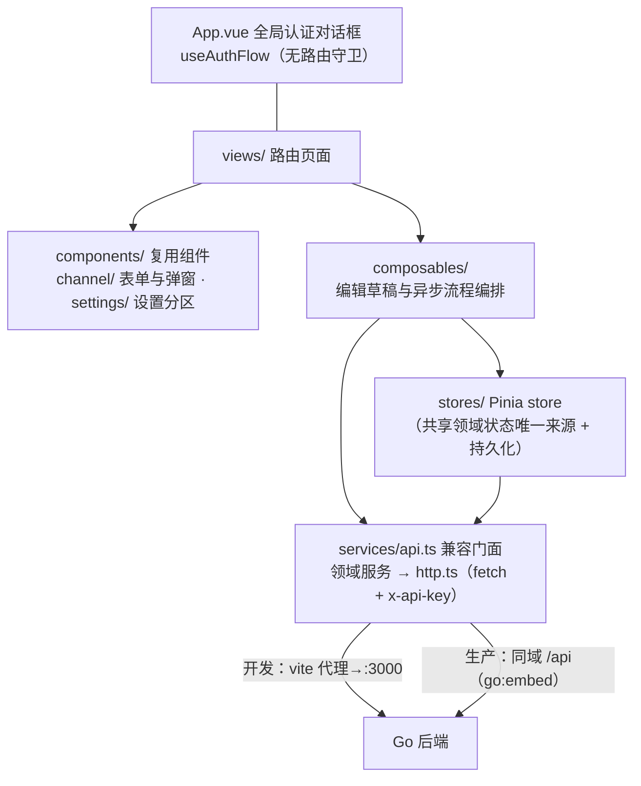

# 架构说明（architecture）

本文说明前后端如何协作、代理请求如何流转，以及调度、资源管理和数据存储的职责划分。修改跨模块逻辑前，应先核对这里描述的流程，再阅读 [规范与不变量.md](规范与不变量.md) 中的行为约束。

## 存储连接与对话缓存

装配层为 `conversations.db`、`blocked-logs.db` 各创建一个单连接池，分别借给 session/conversation 和 blocked/gate 存储。使用方只停止自身后台工作，底层连接在所有使用方停止后由装配层关闭；独立路径构造的存储仍自行拥有连接。业务连接采用 512KiB 目标页缓存，日志库继续独立维护写连接与只读池。

持久化对话注册表启动时在数据库侧清理过期历史，不全量恢复正文、别名或消息指纹索引。请求按明确身份或 frontier 索引恢复候选，空闲记录受条数和估算字节预算约束；活跃请求和落库失败状态不能淘汰。列表通过数据库分页、筛选与排序，发送状态由当前进程内存快照覆盖。

## 1. 整体形态：单二进制一体化

Vue 3 前端构建后，通过 `go:embed` 嵌入 Go 后端。部署时，一个可执行文件就在同一端口提供代理 API、管理 API 和 Web 管理界面。

`ChannelKind` 和 `ServiceType` 描述的是请求的不同侧面。`ChannelKind` 区分 messages、responses、gemini、chat 和 images 五类入口，也是指标分组的依据；`ServiceType` 则表示 openai、claude、gemini 或 responses 上游服务类型。共享准入按实际上游协议分配名额：Images 的原生 openai 上游会识别为 `images`，因此不会与 Chat 混用名额。相关定义见 `scheduler/channel_scheduler.go` 和 `config/config_concurrency.go`。

## 2. 代理请求流转（五协议统一入口）

五类协议的主请求由 `handlers/proxycore/protocol.go` 中的 `RunProxyRequest` 统一编排，各协议通过 `ProtocolSpec` 提供解析、请求构造和响应处理等差异逻辑。下图描述这条主流程。

Responses `/compact` 使用独立的控制请求入口，仍复用选渠、上游尝试、内容安全检查和会话归属机制，但不会发起图片理解调用。Messages `count_tokens` 和模型目录也有各自的处理入口。

### 模型目录

`modelcatalog` 从同一份配置快照生成公开目录，`handlers/modelapi` 统一处理协议筛选和响应格式。普通分组暴露匹配词作为模型 ID，兜底分组不产生模型条目，启用的免费分组只暴露 `free` 入口。完整 `free/厂商/模型` 仍可手动请求及查询详情。查询不会访问上游；列入目录不代表已验证可用性。

Messages、Responses、Chat、Gemini 的免费请求共用 `proxycore` 选模路径，实际上游均为 Kilo Chat。`free` 按当前入口真实请求的近期健康状态、平滑成功率排序，同分保留清单顺序；显式模型优先，冷却中的候选暂时跳过，近期明确不支持的模型不进入自动选择。Kilo 自身的自动入口排在具体模型之后。单次请求最多尝试 3 个模型，60 秒后不再开启新模型尝试，同时遵守共享发送预算；已交付内容后不能切换模型。候选始终限于免费清单，不转付费兜底，也不受普通渠道的 Fuzzy 开关限制。

| 查询入口 | 目录范围与格式 |
|---|---|
| `GET /v1/models` | 默认全部入口分组，按 ID 去重，OpenAI 列表格式 |
| `GET /v1/models?type=messages` | 仅 Messages 入口分组；type 同样支持 responses、chat、gemini、images、embeddings、decisions |
| `GET /v1/models` + `X-API-Proxy-Type: responses` | 通过请求头指定入口，适用于不便传查询参数的 SDK |
| `GET /v1/models` + `anthropic-version` 请求头 | 默认 Messages 目录，Anthropic 列表格式 |
| `GET /v1beta/models` | 仅 Gemini 入口目录，Gemini 原生列表格式 |
| `GET /api/proxy-models?type=messages` | 管理页导入使用相同筛选逻辑，固定返回 OpenAI 格式，走管理组鉴权 |

筛选依据是分组所在的入口协议，与渠道实际使用的上游协议无关。免费模型只归属 Messages、Responses、Chat、Gemini 四个入口。`type` 与 `X-API-Proxy-Type` 同时传入时必须一致，未知协议、重复或空参数返回 400，避免误导入其他入口的模型。

`/v1/models` 可用 `format=openai|anthropic` 显式选择响应格式；入口范围由 type、协议请求头决定，未指定范围的 Anthropic 格式默认 Messages。`/v1beta/models` 固定 Gemini 范围和格式。两种路径都支持追加完整模型 ID 查询详情（包括含斜杠的免费模型），不属于当前入口目录的 ID 返回 404。

Anthropic 列表支持 `limit`（默认 20，最大 1000）、`after_id`、`before_id`；Gemini 列表支持 `pageSize`（默认 50，最大 1000）、`pageToken`，下一页游标取自 `nextPageToken`。目录变化导致游标失效时返回 400，客户端应重新获取列表。目录只提供分组别名所能确认的元数据，不推断真实模型的上下文长度或模态；Anthropic 的未知创建时间沿用 `created=0` 对应的 UTC 时间。

公开查询继续使用代理密钥鉴权，接受 `Authorization: Bearer ...`、`x-api-key` 或 `x-goog-api-key` 请求头，不接受 URL 查询参数中的密钥。向上游查询模型列表仍由独立的模型发现流程负责，按渠道的实际 `serviceType` 选择协议。

要点：

- 新增协议时，需要实现 `ProtocolSpec` 钩子、注册端点，并接入对应的配置、指标和管理路由。现有实现可参考 `handlers/messages/handler.go`。
- Provider 的流式转换使用 `HandleStreamResponseCtx`。原生转发也需要传播请求 context，并在退出时关闭上游 body，保证客户端断连后停止读取。
- 取得 `ChannelPermit` 后用 defer 登记释放，结束时先记录一次健康结果，再释放许可。相关方法支持幂等调用，但一个尝试只能记入一个健康结果。
- Messages 转换为 Responses 时，构造请求与处理成功响应必须复用同一个 Provider 实例。实例保存在 Gin context 中，重新创建会丢失 `previous_response_id` 链。
- Claude 原生上游（`serviceType=claude`）的非流式响应在无需校正 usage 时原样下发，保留 `safeguards`、`safeguard_results` 等未知字段，也不改写 tool-use ID。需要校正 usage 时，只修改对应字段。其他上游仍需协议转换，不能承担 Claude Code 服务端分类器。

## 3. 调度与稳定性体系

生产请求默认按配置顺序选择渠道。开启促销的健康渠道可以在所属分组内临时优先，但仍需通过健康检查和熔断准入；对话路由覆盖的优先级高于促销，促销也不会跨越分组。时长或成功请求次数中的任一限制达到后，渠道恢复原有顺序。恢复探测同样按配置顺序执行，性能画像只用于观测，不参与排序。

失败率用于跳过不健康渠道，不用于重新排序。只有当前入口协议开启 Fuzzy 的多渠道请求允许故障后切换渠道，单渠道请求仍需遵守共享准入限制。各协议开关保存在 `fuzzyModeByProtocol`，未单独配置时继承旧 `fuzzyModeEnabled` 值；管理页面的切换仅更新当前协议。协议转换仍按入口协议决定故障转移，Responses compact 与内部辅助调用也读取对应协议的状态。熔断器同时检查连续失败次数和错误率，默认阈值为连续失败 4 次或错误率达到 60%，冷却时间为 60 秒。

`upstreamcontrol` 按 URL、实际上游协议和 API Key 汇总准入规则。相同组合即使出现在不同入口，也共用最小的配置并发上限。配置提交或热重载时，`ConfigManager.publishConfigLocked` 更新规则，同时保留正在执行的请求计数和 FIFO 队列。每个组合默认允许 5 个并发请求、3 个排队请求，单次排队最多等待 10 秒。取消请求会退出队列，失败重试需要重新排队，上游响应 body 关闭后归还执行名额。主请求、辅助推理和兼容重试共用最多 12 次发送、累计 30 秒准入等待的预算。

渠道状态包括 active、suspended、disabled、deprecated 和 deleted。临时渠道到期后转为 deprecated，弃用超过 3 天后转为 deleted，保留删除占位；促销则按时长或请求次数结束。生命周期处理见 `config/config_utils.go`、`config/config_lifecycle.go` 和 `config/config_channel_status.go`。

五组渠道配置分别保存在 upstream、responsesUpstream、geminiUpstream、chatUpstream 和 imagesUpstream 中，支持 `modelMapping` 一对多、`poolId` 和 vision layer 等字段。五类管理路由由 `setupChannelAdminAPI` 统一装配，复用同一组 CRUD handler；性能报告由管理 handler 直接读取 `ProfileManager` 快照。

## 4. 应用装配与生命周期

`newApp()` 按依赖顺序创建组件：先读取启动配置并初始化 ConfigManager，迁移缺失的旧环境变量设置；确定日志路径和指标保留期后，再创建日志、内容安全、会话、对话注册表和指标存储。随后装配 URL 管理、调度器、熔断器、命令闸门和可逆脱敏，最后注册 pi-agent、skills、assistant 等管理接口，并创建 Gin 引擎。

- 每个资源创建成功后登记释放动作。启动失败和正常关闭都通过 `app.shutdown()` 按逆序清理，重复或并发关闭只释放一次。一项清理失败时，仍继续回收其他资源，并汇总错误。
- 正常关闭先等待在途 HTTP 请求完成。若等待超时，则关闭连接以触发请求取消，待 handler 退出后再释放应用资源。后台任务的 `Stop` 也要等循环实际退出，之后才能关闭依赖的存储；日志存储最后关闭。
- 调度器构造成功前，装配层负责回收指标和 Trace 亲和相关资源；构造成功后，由调度器统一停止这些组件。已启用的指标存储若初始化失败，启动直接返回错误。
- 请求与日志策略保存在 `settings.gateway`，旧环境变量只用于迁移缺失字段。客户端伪装版本保存在 `settings.disguise`，启动、保存设置和文件热重载时立即应用本地版本。后台 npm 查询只更新 latest 缓存，保存接口不等待网络；关闭自动跟随后，不使用 latest。状态接口返回查询错误和最后成功时间，应用关闭时会取消查询并等待任务退出。

## 5. 前端架构

- 认证由全局密钥对话框处理，未认证时阻止用户操作应用。连续 5 次认证失败会锁定 5 分钟，只有 401 响应会被视为密钥无效。
- `ApiTab` 表示五种入口协议。store 使用 `Record<ApiTab, ...>` 分组保存数据，`channelApi(type)` 返回对应协议的共用操作方法。新增协议时，需要同步修改类型、store、API 工厂和路由校验。
- `ApiError.committed` 表示配置已经原子提交，但后续处理失败。此时不能自动重试，界面应提示用户刷新并查看实际状态。
- 设置分区和渠道弹窗共用父级编辑器，切换分区时保留局部草稿。已保存的共享渠道数据由 store 持有，取消编辑不会修改这些数据。
- 各领域 API 服务声明端点和返回类型，`http.ts` 统一处理鉴权、响应解析和错误，`api.ts` 保留原有导入入口和方法名。需要鉴权的 SSE 通过 fetch 和 `readSSEStream` 读取，以便携带访问密钥。

## 6. 数据存储

主配置保存在 JSON 文件中，业务数据使用 modernc.org/sqlite，并开启 WAL。日志库将写入与查询分开，使用一个写连接和最多 4 个只读连接；其余业务库使用单连接。各存储自行执行建表和列升级 SQL，JSON 配置迁移由 config 包处理，没有外部 migration 框架。

默认文件路径相对于进程工作目录。日志库路径可以通过 `settings.gateway.logDBPath` 修改，重启后生效。各文件的用途如下：

| 文件 | 用途 | 使用方 |
|---|---|---|
| `.config/config.json` | 主配置（五组渠道 + settings），热重载，保留 10 份备份 | ConfigManager |
| `.config/logs.db` | 运行日志、流量正文、正文去重引用与会话摘要索引 | logger、metrics.RequestLogStore、cli（`api-proxy logs`） |
| `.config/blocked-logs.db` | 拦截记录 + 危险命令闸门 | sensitive、handlers/hooks |
| `.config/conversations.db` | 对话注册表 + Responses 会话与 response ID 归属 | conversation、session |
| `.config/metrics.db` | 指标持久化（可选） | metrics |
| `.config/redaction-mappings.db` + `.config/master-key` | 可逆脱敏持久映射（AES-256-GCM） | sensitive（Veil ADR 0004） |
| `.config/assistant.db` | AI 配置助手 | assistant |

## 7. 鉴权模型（三层）

| 层 | 中间件 | 保护对象 | 密钥来源 |
|---|---|---|---|
| 页面开关 | WebAuthMiddleware | WebUI 页面（ENABLE_WEB_UI） | 只管页面开关，不碰管理业务 |
| 管理 API | AdminAuthMiddleware（**必须显式绑定在路由组上**，漏绑会打 `[Auth-Warn]`） | `/api/*`、`/admin/*` | PROXY_ACCESS_KEY，经 x-api-key / Authorization Bearer / x-goog-api-key 提取 |
| 代理端点 | ProxyAuthMiddleware（主流程或独立控制入口内部调用） | `/v1/*`、`/v1beta/*` | 同一个 PROXY_ACCESS_KEY，支持上述三种提取方式 |

`/health` 固定公开（与 Dockerfile HEALTHCHECK 一致）。v3.3.0 修复过 WebAuthMiddleware 扩展名绕过（7e0b11b），改动鉴权相关代码时格外谨慎。
