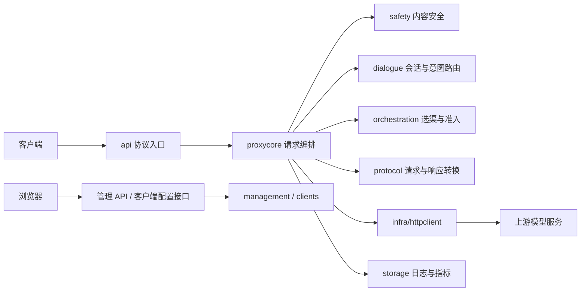

# 架构说明

Go 后端与 Vue 管理台共用一个进程、一个端口（默认 3000）。前端静态资源在构建时嵌入二进制。后端目录职责见 [后端约定](../backend-go/AGENTS.md)，前端目录见 [前端约定](../frontend/AGENTS.md)。

## 请求经过哪些模块

cmd/server 负责依赖装配、路由和生命周期。api 处理 HTTP 与协议差异；通用请求流程由 proxycore.RunProxyRequest 编排，差异通过 ProtocolSpec 注入。安全、转换和调度组件不反向依赖 HTTP 接入层。

客户端配置接口集中在 clients 顶层；piagent、mcpsync、skills 子包处理配置与文件操作，不依赖 HTTP。前端的 app 组合业务流程，features 各自拥有视图与服务，通过少量公开出口协作；shared 提供通用能力，types 保存契约。

## 协议与渠道

| 类型 | 入口 | 行为 |
|---|---|---|
| 五类编排协议 | `/v1/messages`、`/v1/responses`（含 compact）、`/v1/chat/completions`、`/v1beta/models/*`、`/v1/images/*` | 统一选渠、重试与安全处理，按上游能力转换 |
| 原样透传 | `/v1/embeddings`、`/v1/decisions` | 路由到对应上游，保留请求与响应格式 |

ChannelKind 表示 messages / responses / chat / gemini / images / embeddings / decisions 七类入口分组；ServiceType 表示上游实际协议。Images 支持原生 Images 上游与 Responses 生图上游。

渠道允许全部删除。删除自定义分组时会一并删除其全部渠道（包括暂停、备用、弃用及纯图片理解渠道），由后端原子提交。渠道与分组的 `GET /api/{kind}/channels/{id}/deletion-impact`、`GET /api/{kind}/pools/{id}/deletion-impact` 返回删除范围及图片理解引用渠道，供组件确认框展示；预览不修改配置。删除时按最新配置关闭引用方的图片理解支持和图片理解层，清空图片理解渠道与模型选择，与删除一同提交；写入失败保持原配置。兜底分组与内置免费分组不能删除，被意图路由引用的分组须先解除意图引用。

内部意图分类和命令闸门可通过 Decisions 调用结构化辅助问答；systemone 只保留为旧配置别名，不请求 `/v1/systemone`。这不约束对外 Decisions 透传的载荷格式。

## 主请求流程

鉴权与读体 → 安全处理与会话识别 → 选组、选渠 → 构建上游请求 → 共享准入 → HTTP 发送 → 响应转换 / SSE 转发 → 关闭响应体、释放许可、记录日志和健康结果。

- 正常选渠遵循配置顺序；促销只在同组生效，会话绑定优先。性能画像只供观测。
- 共享准入按实际 URL、上游协议、Key 聚合；不同逻辑渠道共用凭据时共享并发与排队。
- 重试受发送次数和累计排队预算限制。流已交付后不能当作完整失败重新发送。
- 意图路由共用预览与实际决策快照；驻留、工具续轮、加密历史和人工固定具有保护规则。免费组需配置能力且服务启用才参与自动选组，不新增跨组故障转移。
- 流式处理传播请求 Context，客户端断开或处理结束时关闭上游 Body。

代码修改必须保留的具体约束见 [规范与不变量](规范与不变量.md)。

## 数据与观测

运行数据放 `.config/`：config.json 保存配置；SQLite 分别保存日志、拦截与审核、会话、指标、脱敏映射、助手状态；master-key 保存脱敏主密钥。该目录不可入仓。

logs.db 记录调用生命周期、尝试、工具关联与受限正文；正文按哈希去重。请求入口固定采集策略，运行日志、调用和正文分别设置保留期。存储预算是软上限，超预算时新请求降为元数据；写入拒收或失败会报告错误，详情超限返回 413。

观测只覆盖网关收到与发出的内容。上游状态、客户端 HTTP 状态和处理结果分别记录；流式 HTTP 200 不表示最终成功，工具关联不表示客户端工具已执行。

## 鉴权与停机

管理 `/api/*` 路由显式挂 AdminAuthMiddleware；代理入口使用 ProxyAuthMiddleware；WebAuthMiddleware 控制 ENABLE_WEB_UI，`/health` 始终公开。

停机先排空 HTTP 请求，再停止后台生产者，最后排空日志并关闭存储。启动失败也按依赖逆序清理。
